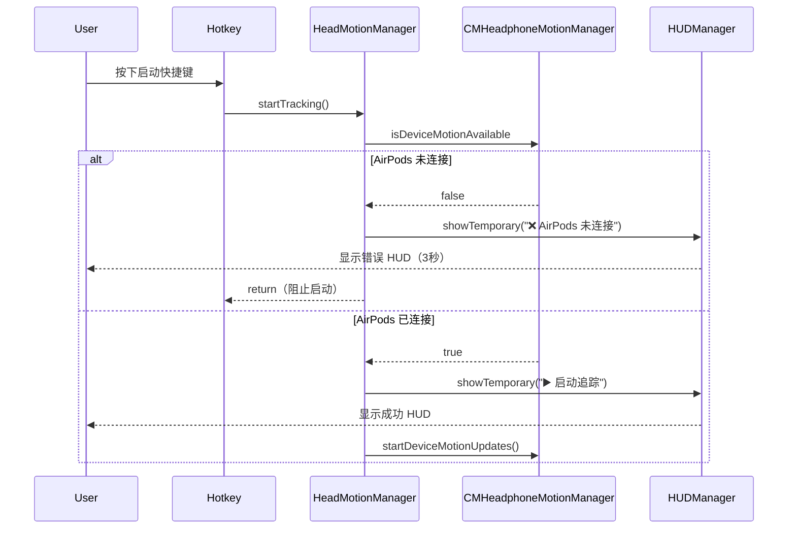
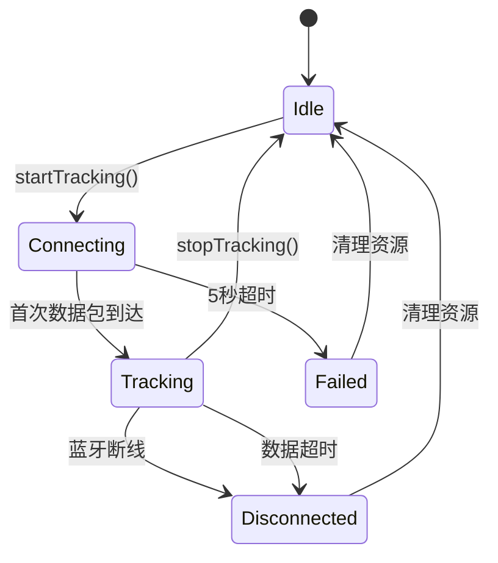
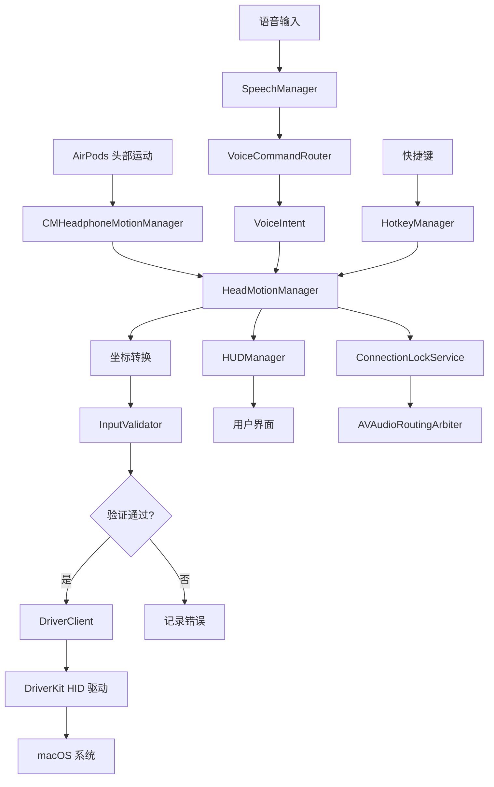

# 设计文档：Project Aether 审核改进

## 概述

本设计文档详细说明了 Project Aether 全面审核后发现的关键问题和改进机会的技术实现方案。Project Aether 是一个基于 AirPods 头部追踪、语音识别和 DriverKit 虚拟 HID 驱动的 macOS 交互系统。

### 设计目标

1. **功能完整性**：实现滚动和拖拽等缺失的核心功能
2. **用户体验**：提供即时、清晰的系统状态反馈
3. **代码质量**：从 7.5/10 提升到 9/10
4. **测试覆盖**：从 0% 提升到 70%
5. **可维护性**：引入依赖注入和状态机模式
6. **稳定性**：添加输入验证和错误处理

### 技术约束

- Swift 5.9+
- macOS 13.0+
- Apple DriverKit 规范
- 保持现有 API 兼容性
- 支持 7 种语言（中文、英文、日文、韩文、法文、德文、西班牙文）

### 优先级说明

- **P0（立即执行，1-2周）**：影响核心功能的严重问题
- **P1（短期执行，2-4周）**：影响用户体验和稳定性的重要改进
- **P2（中期执行，1-2个月）**：提升代码质量和可维护性的架构改进

## 架构

### 当前架构概览

Project Aether 采用分层架构，主要组件包括：

```
┌─────────────────────────────────────────────────────────────┐
│                        UI Layer                              │
│  ┌──────────────┐  ┌──────────────┐  ┌──────────────┐      │
│  │  ContentView │  │  HUDManager  │  │  MenuBar     │      │
│  └──────────────┘  └──────────────┘  └──────────────┘      │
└─────────────────────────────────────────────────────────────┘
                            │
┌─────────────────────────────────────────────────────────────┐
│                    Application Layer                         │
│  ┌──────────────────┐  ┌──────────────────┐                │
│  │ HeadMotionManager│  │  SpeechManager   │                │
│  └──────────────────┘  └──────────────────┘                │
│  ┌──────────────────┐  ┌──────────────────┐                │
│  │  HotkeyManager   │  │ ConnectionLock   │                │
│  └──────────────────┘  └──────────────────┘                │
└─────────────────────────────────────────────────────────────┘
                            │
┌─────────────────────────────────────────────────────────────┐
│                   Automation Layer                           │
│  ┌──────────────────────────────────────────────────────────┤
│  │         AutomationOutput Protocol                        │
│  ├──────────────────┬──────────────────┐                    │
│  │ CoreGraphics     │  DriverKit       │                    │
│  │ Implementation   │  Implementation  │                    │
│  └──────────────────┴──────────────────┘                    │
└─────────────────────────────────────────────────────────────┘
                            │
┌─────────────────────────────────────────────────────────────┐
│                    Driver Layer                              │
│  ┌──────────────────┐  ┌──────────────────┐                │
│  │  DriverClient    │  │  AetherDriver    │                │
│  │  (User Space)    │  │  (DriverKit)     │                │
│  └──────────────────┘  └──────────────────┘                │
└─────────────────────────────────────────────────────────────┘
```

### 改进后的架构

改进后的架构将引入以下变化：

1. **依赖注入容器**：管理组件生命周期和依赖关系
2. **状态机**：统一管理追踪状态转换
3. **输入验证层**：在 DriverClient 前添加验证
4. **测试抽象层**：协议化核心组件以支持测试


## 组件和接口

### P0 组件设计

#### 1. 滚动功能实现

##### 1.1 VoiceIntent 枚举扩展

```swift
enum VoiceIntent: Equatable, Sendable {
    // 现有指令...
    case clickLeft
    case clickRight
    // ... 其他现有指令
    
    // 新增滚动指令
    case scrollUp
    case scrollDown
    case scrollLeft
    case scrollRight
    case scrollToTop
    case scrollToBottom
}
```

##### 1.2 VoiceCommandRouter 路由逻辑

在 `VoiceCommandRouter.route()` 方法中添加滚动指令识别：

```swift
func route(transcript raw: String, isTypingMode: Bool = false) -> VoiceIntent {
    let s = raw.lowercased().replacingOccurrences(of: " ", with: "")
    
    // 滚动指令识别（支持多语言）
    if s.contains("向上滚动") || s.contains("scrollup") || s.contains("上滚") {
        return .scrollUp
    }
    if s.contains("向下滚动") || s.contains("scrolldown") || s.contains("下滚") {
        return .scrollDown
    }
    if s.contains("滚动到顶部") || s.contains("scrolltotop") || s.contains("到顶") {
        return .scrollToTop
    }
    if s.contains("滚动到底部") || s.contains("scrolltobottom") || s.contains("到底") {
        return .scrollToBottom
    }
    
    // ... 现有逻辑
}
```

##### 1.3 HeadMotionManager 头部倾斜检测

在 `HeadMotionManager` 中添加头部倾斜滚动逻辑：

```swift
class HeadMotionManager: ObservableObject {
    // 配置参数
    private let tiltScrollThreshold: Double = 0.262 // ~15度（0.262弧度）
    private let tiltScrollSensitivity: Double = 5.0
    private var lastScrollTime: Date = Date()
    private let scrollRateLimit: TimeInterval = 0.016 // 60Hz
    
    @Published var isTiltScrollEnabled: Bool = UserDefaults.standard.bool(
        forKey: "isTiltScrollEnabled"
    ) {
        didSet {
            UserDefaults.standard.set(isTiltScrollEnabled, forKey: "isTiltScrollEnabled")
        }
    }
    
    private func handleTiltScroll(pitch: Double) {
        guard isTiltScrollEnabled else { return }
        guard isTracking else { return }
        
        let now = Date()
        let dt = now.timeIntervalSince(lastScrollTime)
        
        // 速率限制：最大 60Hz
        guard dt >= scrollRateLimit else { return }
        lastScrollTime = now
        
        var scrollDy: Int = 0
        
        if pitch < -tiltScrollThreshold {
            // 头部向后倾斜 -> 向上滚动
            let amount = pow((abs(pitch) - tiltScrollThreshold) * 10, 1.5)
            scrollDy = Int(amount * tiltScrollSensitivity)
        } else if pitch > tiltScrollThreshold {
            // 头部向前倾斜 -> 向下滚动
            let amount = pow((pitch - tiltScrollThreshold) * 10, 1.5)
            scrollDy = -Int(amount * tiltScrollSensitivity)
        }
        
        if scrollDy != 0 {
            AutomationOutputs.shared.scroll(dx: 0, dy: scrollDy)
            
            if isDebugModeEnabled {
                os_log("Tilt Scroll: pitch=%.3f, dy=%d", 
                       log: log, type: .debug, pitch, scrollDy)
            }
        }
    }
}
```

##### 1.4 AutomationOutput 协议扩展

`AutomationOutput` 协议已经包含 `scroll(dx:dy:)` 方法，无需修改。

##### 1.5 坐标系和滚动方向映射

macOS 滚动坐标系：
- **dy > 0**：内容向上移动（用户看到下方内容）
- **dy < 0**：内容向下移动（用户看到上方内容）
- **dx > 0**：内容向左移动（用户看到右侧内容）
- **dx < 0**：内容向右移动（用户看到左侧内容）

头部倾斜映射：
- **pitch < -0.262**（头向后仰）→ dy > 0（向上滚动）
- **pitch > 0.262**（头向前倾）→ dy < 0（向下滚动）


#### 2. 拖拽功能实现

##### 2.1 拖拽状态管理

在 `HeadMotionManager` 中添加拖拽状态：

```swift
class HeadMotionManager: ObservableObject {
    // 拖拽状态
    @Published var isDragging: Bool = false
    private var dragStartTime: Date?
    private let dragTimeoutSeconds: TimeInterval = 30.0
    private var dragTimeoutTimer: Timer?
    
    func startDrag() {
        guard !isDragging else { return }
        guard isTracking else {
            HUDManager.shared.showTemporary(
                message: "❌ " + String(localized: "drag.error.not_tracking"),
                icon: "exclamationmark.triangle"
            )
            return
        }
        
        isDragging = true
        dragStartTime = Date()
        
        // 在当前光标位置按下鼠标左键
        AutomationOutputs.shared.drag(start: true, at: nil)
        
        // 显示 HUD 反馈
        HUDManager.shared.showTemporary(
            message: "✊ " + String(localized: "drag.started"),
            icon: "hand.raised.fill"
        )
        
        // 启动超时定时器
        startDragTimeoutTimer()
        
        os_log("Drag started", log: log, type: .info)
    }
    
    func endDrag() {
        guard isDragging else { return }
        
        isDragging = false
        dragStartTime = nil
        dragTimeoutTimer?.invalidate()
        dragTimeoutTimer = nil
        
        // 在当前光标位置释放鼠标左键
        AutomationOutputs.shared.drag(start: false, at: nil)
        
        // 显示 HUD 反馈
        HUDManager.shared.showTemporary(
            message: "🖐 " + String(localized: "drag.ended"),
            icon: "hand.point.up.fill"
        )
        
        os_log("Drag ended", log: log, type: .info)
    }
    
    private func startDragTimeoutTimer() {
        dragTimeoutTimer?.invalidate()
        dragTimeoutTimer = Timer.scheduledTimer(
            withTimeInterval: dragTimeoutSeconds,
            repeats: false
        ) { [weak self] _ in
            self?.handleDragTimeout()
        }
    }
    
    private func handleDragTimeout() {
        guard isDragging else { return }
        
        os_log("Drag timeout after %.0f seconds", 
               log: log, type: .warning, dragTimeoutSeconds)
        
        // 自动释放鼠标按键
        AutomationOutputs.shared.drag(start: false, at: nil)
        
        isDragging = false
        dragStartTime = nil
        
        // 显示超时警告
        HUDManager.shared.showTemporary(
            message: "⚠️ " + String(localized: "drag.timeout"),
            icon: "clock.badge.exclamationmark"
        )
    }
}
```

##### 2.2 VoiceIntent 扩展

```swift
enum VoiceIntent: Equatable, Sendable {
    // ... 现有指令
    case dragStart
    case dragEnd
}
```

##### 2.3 VoiceCommandRouter 拖拽指令识别

```swift
func route(transcript raw: String, isTypingMode: Bool = false) -> VoiceIntent {
    let s = raw.lowercased().replacingOccurrences(of: " ", with: "")
    
    // 拖拽指令识别（支持多语言）
    if s.contains("开始拖拽") || s.contains("startdrag") || s.contains("抓住") {
        return .dragStart
    }
    if s.contains("结束拖拽") || s.contains("enddrag") || s.contains("放下") || s.contains("松开") {
        return .dragEnd
    }
    
    // ... 现有逻辑
}
```

##### 2.4 HUD 视觉反馈

在 `HUDState` 中添加拖拽状态指示：

```swift
class HUDState: ObservableObject {
    @Published var isDragging: Bool = false
    
    var statusIcon: String {
        if isDragging {
            return "hand.raised.fill"
        }
        // ... 现有逻辑
    }
    
    var statusMessage: String {
        if isDragging {
            return String(localized: "hud.dragging")
        }
        // ... 现有逻辑
    }
}
```

##### 2.5 HID 事件序列

拖拽操作的 HID 事件序列：

1. **开始拖拽**：
   ```swift
   // 发送 mouseDown 事件（button bit 0 = 1）
   client.postHIDEvent(dx: 0, dy: 0, buttons: 1)
   ```

2. **拖拽中**：
   ```swift
   // 持续发送 mouseMoved 事件（button bit 0 保持 = 1）
   client.postHIDEvent(dx: deltaX, dy: deltaY, buttons: 1)
   ```

3. **结束拖拽**：
   ```swift
   // 发送 mouseUp 事件（button bit 0 = 0）
   client.postHIDEvent(dx: 0, dy: 0, buttons: 0)
   ```


#### 3. 快捷键启动反馈

##### 3.1 AirPods 连接状态检测流程

```swift
class HeadMotionManager: ObservableObject {
    // 公共 API 用于检查 AirPods 可用性
    var isAirPodsAvailable: Bool {
        // 如果已经在追踪，AirPods 肯定已连接
        if motionManager.isDeviceMotionActive || isAirPodsStreamActive {
            return true
        }
        
        // 检查设备是否支持运动追踪
        return motionManager.isDeviceMotionAvailable
    }
    
    func startTracking() {
        guard !isTracking else { return }
        
        // 关键：在启动前验证 AirPods 是否真正可用
        if !motionManager.isDeviceMotionAvailable {
            let msg = String(localized: "motion.error.airpods_not_detected")
            attitudeText = "AirPods not connected"
            os_log("Cannot start tracking: AirPods not available", 
                   log: log, type: .error)
            
            // 显示错误 HUD
            HUDManager.shared.showTemporary(
                message: "❌ " + String(localized: "hud.airpods_not_connected"),
                icon: "airpodspro.slash"
            )
            
            // 调用错误回调
            onError?(msg)
            
            // 阻止追踪启动
            return
        }
        
        // ... 继续启动逻辑
    }
}
```

##### 3.2 快捷键处理逻辑

在 `HeadMotionManager` 的事件回调中：

```swift
private func callback(proxy: CGEventTapProxy, type: CGEventType, 
                     event: CGEvent, refcon: UnsafeMutableRawPointer?) 
                     -> Unmanaged<CGEvent>? {
    // ... 现有逻辑
    
    if let action = HotkeyManager.shared.matchKeyDown(keyCode: keyCode, flags: flags) {
        switch action {
        case .toggleTracking:
            if manager.isTracking {
                GlobalLogger.input.info("Hotkey: Stop Tracking")
                HUDManager.shared.showTemporary(
                    message: "⏹ " + String(localized: "hud.stop_tracking")
                )
                DispatchQueue.main.async { manager.stopTracking() }
            } else {
                GlobalLogger.input.info("Hotkey: Start Tracking")
                
                // 检查 AirPods 连接状态
                if !manager.isAirPodsAvailable {
                    HUDManager.shared.showTemporary(
                        message: "❌ " + String(localized: "hud.airpods_not_connected"),
                        icon: "airpodspro.slash"
                    )
                    return nil
                }
                
                HUDManager.shared.showTemporary(
                    message: "▶️ " + String(localized: "hud.start_tracking")
                )
                DispatchQueue.main.async { manager.startTracking() }
            }
            return nil
        // ... 其他 action
        }
    }
    
    return Unmanaged.passUnretained(event)
}
```

##### 3.3 错误 HUD 显示逻辑

```swift
class HUDManager {
    func showTemporary(message: String, language: String? = nil, 
                      icon: String = "info.circle") {
        update(mode: .command, message: message, 
               language: language ?? state.language, 
               inputDeviceIcon: icon)
        scheduleHide(delay: 3.0) // 错误消息显示 3 秒
    }
    
    private func scheduleHide(delay: TimeInterval) {
        hideTask?.cancel()
        hideTask = DispatchWorkItem { [weak self] in
            self?.hide()
        }
        DispatchQueue.main.asyncAfter(deadline: .now() + delay, 
                                     execute: hideTask!)
    }
}
```

##### 3.4 启动失败处理流程




#### 4. 单元测试框架

##### 4.1 测试目标结构

```
AetherTests/
├── HeadMotionManagerTests.swift
├── DriverClientTests.swift
├── VoiceCommandRouterTests.swift
├── CoordinateTransformTests.swift
├── AutomationOutputTests.swift
├── HotkeyManagerTests.swift
├── ConnectionLockServiceTests.swift
└── Mocks/
    ├── MockDriverClient.swift
    ├── MockCMHeadphoneMotionManager.swift
    ├── MockAutomationOutput.swift
    └── MockHUDManager.swift
```

##### 4.2 协议化核心组件

为了支持测试，需要将核心组件协议化：

```swift
// MARK: - DriverClient Protocol
protocol DriverClientProtocol {
    var isConnected: Bool { get }
    func connectIfNeeded(throttleSeconds: TimeInterval) -> Result<Void, DriverClient.Error>
    func postHIDEvent(dx: Int32, dy: Int32, buttons: UInt32) -> Result<Void, DriverClient.Error>
    func disconnect()
}

extension DriverClient: DriverClientProtocol {}

// MARK: - AutomationOutput Protocol (已存在，无需修改)
protocol AutomationOutput {
    func moveCursor(to point: CGPoint, desktopMaxY: CGFloat)
    func mouseClick(at point: CGPoint, button: CGMouseButton, clickCount: Int)
    func scroll(dx: Int, dy: Int)
    func drag(start: Bool, at point: CGPoint?)
    // ... 其他方法
}

// MARK: - HUDManager Protocol
protocol HUDManagerProtocol {
    func update(mode: HUDMode, message: String, language: String, inputDeviceIcon: String)
    func showTemporary(message: String, language: String?, icon: String)
    func hide()
}

extension HUDManager: HUDManagerProtocol {}
```

##### 4.3 Mock 对象设计

```swift
// MARK: - MockDriverClient
class MockDriverClient: DriverClientProtocol {
    var isConnected: Bool = false
    var connectCallCount: Int = 0
    var postHIDEventCallCount: Int = 0
    var lastPostedEvent: (dx: Int32, dy: Int32, buttons: UInt32)?
    var shouldFailConnect: Bool = false
    var shouldFailPostEvent: Bool = false
    
    func connectIfNeeded(throttleSeconds: TimeInterval) -> Result<Void, DriverClient.Error> {
        connectCallCount += 1
        if shouldFailConnect {
            return .failure(.serviceNotFound)
        }
        isConnected = true
        return .success(())
    }
    
    func postHIDEvent(dx: Int32, dy: Int32, buttons: UInt32) -> Result<Void, DriverClient.Error> {
        postHIDEventCallCount += 1
        lastPostedEvent = (dx, dy, buttons)
        if shouldFailPostEvent {
            return .failure(.callFailed(KERN_FAILURE))
        }
        return .success(())
    }
    
    func disconnect() {
        isConnected = false
    }
}

// MARK: - MockAutomationOutput
class MockAutomationOutput: AutomationOutput {
    var moveCursorCallCount: Int = 0
    var mouseClickCallCount: Int = 0
    var scrollCallCount: Int = 0
    var dragCallCount: Int = 0
    var lastCursorPosition: CGPoint?
    var lastScrollDelta: (dx: Int, dy: Int)?
    var lastDragState: Bool?
    
    func moveCursor(to point: CGPoint, desktopMaxY: CGFloat) {
        moveCursorCallCount += 1
        lastCursorPosition = point
    }
    
    func mouseClick(at point: CGPoint, button: CGMouseButton, clickCount: Int) {
        mouseClickCallCount += 1
    }
    
    func scroll(dx: Int, dy: Int) {
        scrollCallCount += 1
        lastScrollDelta = (dx, dy)
    }
    
    func drag(start: Bool, at point: CGPoint?) {
        dragCallCount += 1
        lastDragState = start
    }
    
    // ... 其他方法的 mock 实现
}

// MARK: - MockHUDManager
class MockHUDManager: HUDManagerProtocol {
    var updateCallCount: Int = 0
    var showTemporaryCallCount: Int = 0
    var hideCallCount: Int = 0
    var lastMode: HUDMode?
    var lastMessage: String?
    
    func update(mode: HUDMode, message: String, language: String, inputDeviceIcon: String) {
        updateCallCount += 1
        lastMode = mode
        lastMessage = message
    }
    
    func showTemporary(message: String, language: String?, icon: String) {
        showTemporaryCallCount += 1
        lastMessage = message
    }
    
    func hide() {
        hideCallCount += 1
    }
}
```

##### 4.4 测试用例示例

```swift
import XCTest
@testable import AetherCore

class VoiceCommandRouterTests: XCTestCase {
    var router: VoiceCommandRouter!
    
    override func setUp() {
        super.setUp()
        router = VoiceCommandRouter()
    }
    
    override func tearDown() {
        router = nil
        super.tearDown()
    }
    
    // MARK: - 滚动指令测试
    
    func testScrollUpCommand_Chinese() {
        let intent = router.route(transcript: "向上滚动", isTypingMode: false)
        XCTAssertEqual(intent, .scrollUp)
    }
    
    func testScrollUpCommand_English() {
        let intent = router.route(transcript: "scroll up", isTypingMode: false)
        XCTAssertEqual(intent, .scrollUp)
    }
    
    func testScrollDownCommand_Chinese() {
        let intent = router.route(transcript: "向下滚动", isTypingMode: false)
        XCTAssertEqual(intent, .scrollDown)
    }
    
    func testScrollToTopCommand() {
        let intent = router.route(transcript: "到顶", isTypingMode: false)
        XCTAssertEqual(intent, .scrollToTop)
    }
    
    // MARK: - 拖拽指令测试
    
    func testDragStartCommand_Chinese() {
        let intent = router.route(transcript: "开始拖拽", isTypingMode: false)
        XCTAssertEqual(intent, .dragStart)
    }
    
    func testDragEndCommand_English() {
        let intent = router.route(transcript: "end drag", isTypingMode: false)
        XCTAssertEqual(intent, .dragEnd)
    }
}

class DriverClientTests: XCTestCase {
    var mockClient: MockDriverClient!
    
    override func setUp() {
        super.setUp()
        mockClient = MockDriverClient()
    }
    
    func testConnectSuccess() {
        let result = mockClient.connectIfNeeded(throttleSeconds: 2.0)
        
        XCTAssertEqual(mockClient.connectCallCount, 1)
        XCTAssertTrue(mockClient.isConnected)
        
        if case .success = result {
            // 测试通过
        } else {
            XCTFail("Expected success")
        }
    }
    
    func testConnectFailure() {
        mockClient.shouldFailConnect = true
        let result = mockClient.connectIfNeeded(throttleSeconds: 2.0)
        
        XCTAssertEqual(mockClient.connectCallCount, 1)
        XCTAssertFalse(mockClient.isConnected)
        
        if case .failure(let error) = result {
            XCTAssertEqual(error, .serviceNotFound)
        } else {
            XCTFail("Expected failure")
        }
    }
    
    func testPostHIDEvent() {
        mockClient.isConnected = true
        let result = mockClient.postHIDEvent(dx: 10, dy: 20, buttons: 0)
        
        XCTAssertEqual(mockClient.postHIDEventCallCount, 1)
        XCTAssertEqual(mockClient.lastPostedEvent?.dx, 10)
        XCTAssertEqual(mockClient.lastPostedEvent?.dy, 20)
        XCTAssertEqual(mockClient.lastPostedEvent?.buttons, 0)
        
        if case .success = result {
            // 测试通过
        } else {
            XCTFail("Expected success")
        }
    }
}

class CoordinateTransformTests: XCTestCase {
    func testScreenCoordinateToAppKitCoordinate() {
        let desktopMaxY: CGFloat = 1080.0
        let screenPoint = CGPoint(x: 100, y: 200)
        
        // AppKit 坐标系：原点在左下角
        let appKitY = desktopMaxY - screenPoint.y
        
        XCTAssertEqual(appKitY, 880.0)
    }
    
    func testBoundaryCheck() {
        let screenWidth: CGFloat = 1920.0
        let screenHeight: CGFloat = 1080.0
        
        // 测试边界内的点
        XCTAssertTrue(isWithinBounds(x: 100, y: 200, 
                                    width: screenWidth, height: screenHeight))
        
        // 测试边界外的点
        XCTAssertFalse(isWithinBounds(x: -10, y: 200, 
                                     width: screenWidth, height: screenHeight))
        XCTAssertFalse(isWithinBounds(x: 2000, y: 200, 
                                     width: screenWidth, height: screenHeight))
    }
    
    private func isWithinBounds(x: CGFloat, y: CGFloat, 
                               width: CGFloat, height: CGFloat) -> Bool {
        return x >= 0 && x <= width && y >= 0 && y <= height
    }
}
```

##### 4.5 XCTest 集成

在 `Aether.xcodeproj` 中添加测试目标：

1. 创建新的 Test Target：`AetherTests`
2. 配置 Test Host：`AetherCore.app`
3. 添加测试文件到 target
4. 配置 Code Coverage：启用代码覆盖率收集

```xml
<!-- 在 scheme 中启用 Code Coverage -->
<BuildAction>
    <CodeCoverageEnabled>YES</CodeCoverageEnabled>
    <OnlyGenerateCoverageForSpecifiedTargets>YES</OnlyGenerateCoverageForSpecifiedTargets>
</BuildAction>
```


### P1 组件设计

#### 5. 蓝牙断线监听

##### 5.1 AVAudioSession 路由变化监听

```swift
class HeadMotionManager: ObservableObject {
    private var audioRouteObserver: NSObjectProtocol?
    
    private init() {
        setupAudioRouteMonitoring()
        // ... 现有初始化逻辑
    }
    
    deinit {
        if let observer = audioRouteObserver {
            NotificationCenter.default.removeObserver(observer)
        }
    }
    
    private func setupAudioRouteMonitoring() {
        audioRouteObserver = NotificationCenter.default.addObserver(
            forName: AVAudioSession.routeChangeNotification,
            object: AVAudioSession.sharedInstance(),
            queue: .main
        ) { [weak self] notification in
            self?.handleAudioRouteChange(notification)
        }
    }
    
    private func handleAudioRouteChange(_ notification: Notification) {
        guard let userInfo = notification.userInfo,
              let reasonValue = userInfo[AVAudioSessionRouteChangeReasonKey] as? UInt,
              let reason = AVAudioSession.RouteChangeReason(rawValue: reasonValue) else {
            return
        }
        
        os_log("Audio route changed: reason=%d", log: log, type: .info, reason.rawValue)
        
        switch reason {
        case .oldDeviceUnavailable:
            // AirPods 断开连接
            handleAirPodsDisconnected()
            
        case .newDeviceAvailable:
            // 新设备连接（可能是 AirPods 重新连接）
            handleAirPodsReconnected()
            
        case .categoryChange, .override:
            // 其他应用抢占音频路由
            if isTracking {
                checkAirPodsStillConnected()
            }
            
        default:
            break
        }
    }
    
    private func handleAirPodsDisconnected() {
        guard isTracking else { return }
        
        os_log("AirPods disconnected, stopping tracking", log: log, type: .info)
        
        // 立即停止追踪
        stopTrackingInternal()
        
        // 显示断线通知
        HUDManager.shared.showTemporary(
            message: "🔌 " + String(localized: "hud.airpods_disconnected"),
            icon: "airpodspro.slash"
        )
        
        // 释放 Connection Lock
        ConnectionLockService.shared.unlock()
    }
    
    private func handleAirPodsReconnected() {
        os_log("AirPods reconnected", log: log, type: .info)
        
        // 显示重连通知
        HUDManager.shared.showTemporary(
            message: "✅ " + String(localized: "hud.airpods_connected"),
            icon: "airpodspro"
        )
    }
    
    private func checkAirPodsStillConnected() {
        // 检查当前音频路由是否仍然是 AirPods
        let session = AVAudioSession.sharedInstance()
        let currentRoute = session.currentRoute
        
        let hasAirPods = currentRoute.outputs.contains { output in
            output.portType == .bluetoothA2DP || 
            output.portType == .bluetoothHFP ||
            output.portType == .bluetoothLE
        }
        
        if !hasAirPods && isTracking {
            os_log("AirPods no longer in route, stopping tracking", 
                   log: log, type: .warning)
            handleAirPodsDisconnected()
        }
    }
}
```

##### 5.2 断线检测与超时检测的协同

```swift
class HeadMotionManager: ObservableObject {
    private var connectionTimer: Timer?
    private var lastDataTime: Date?
    private let dataTimeoutSeconds: TimeInterval = 5.0
    
    func startTracking() {
        // ... 现有启动逻辑
        
        // 启动连接超时定时器（5秒）
        connectionTimer?.invalidate()
        connectionTimer = Timer.scheduledTimer(
            withTimeInterval: dataTimeoutSeconds,
            repeats: false
        ) { [weak self] _ in
            self?.handleConnectionTimeout()
        }
    }
    
    private func handleConnectionTimeout() {
        guard !isTracking else { return } // 已经连接成功
        
        os_log("Connection timeout - no data received", log: log, type: .error)
        
        let msg = String(localized: "motion.error.connection_timeout")
        HUDManager.shared.showTemporary(
            message: "❌ " + msg,
            icon: "clock.badge.exclamationmark"
        )
        
        onError?(msg)
        stopTrackingInternal()
        
        DispatchQueue.main.async {
            self.attitudeText = "Connection Failed"
        }
    }
    
    // 在运动数据回调中更新心跳时间
    private func handleMotionUpdate(_ motion: CMDeviceMotion) {
        // 首次数据包到达
        if !isTracking {
            guard connectionTimer != nil else { return }
            
            connectionTimer?.invalidate()
            connectionTimer = nil
            isTracking = true
            
            os_log("Connection established (first data received)", log: log)
        }
        
        // 更新心跳时间
        lastDataTime = Date()
        
        // ... 处理运动数据
    }
    
    // 启动心跳检测定时器（在追踪期间持续运行）
    private func startStabilityTimer() {
        stabilityTimer?.invalidate()
        stabilityTimer = Timer.scheduledTimer(
            withTimeInterval: 1.0,
            repeats: true
        ) { [weak self] _ in
            self?.checkDataStability()
        }
    }
    
    private func checkDataStability() {
        guard isTracking else { return }
        guard let lastData = lastDataTime else { return }
        
        let elapsed = Date().timeIntervalSince(lastData)
        
        if elapsed > dataTimeoutSeconds {
            os_log("Data timeout: no updates for %.1f seconds", 
                   log: log, type: .error, elapsed)
            
            // 数据超时，可能是 AirPods 切换到其他设备
            handleAirPodsDisconnected()
        }
    }
}
```

##### 5.3 状态同步机制




#### 6. Connection Lock 优化

##### 6.1 追踪状态联动逻辑

```swift
class HeadMotionManager: ObservableObject {
    func startTracking() {
        guard !isTracking else { return }
        
        // ... AirPods 可用性检查
        
        // 激活 Connection Lock
        ConnectionLockService.shared.lock()
        
        // ... 启动运动追踪
    }
    
    private func stopTrackingInternal() {
        connectionTimer?.invalidate()
        connectionTimer = nil
        
        motionManager.stopDeviceMotionUpdates()
        disableAirPodsCommands()
        
        // 释放 Connection Lock
        ConnectionLockService.shared.unlock()
        
        DispatchQueue.main.async {
            self.dwellOverlay?.orderOut(nil)
            self.dwellOverlay = nil
            if self.isTracking { 
                self.attitudeText = "Stopped" 
            }
            self.isTracking = false
        }
        
        // ... 清理状态
    }
}
```

##### 6.2 锁定/解锁时机

```swift
class ConnectionLockService: ObservableObject {
    static let shared = ConnectionLockService()
    
    @Published private(set) var isLocked: Bool = false
    private let log = OSLog(subsystem: "com.7fei.Aether", category: "ConnectionLock")
    
    func lock() {
        guard !isLocked else { 
            os_log("Connection Lock already active", log: log, type: .debug)
            return 
        }
        
        AVAudioRoutingArbiter.shared.begin(category: .playAndRecordVoice) { [weak self] deviceChanged, error in
            DispatchQueue.main.async {
                if let error {
                    os_log("ConnectionLock: begin failed – %{public}@", 
                           log: self?.log ?? OSLog.default, type: .error, 
                           error.localizedDescription)
                    return
                }
                os_log("ConnectionLock: Locked (deviceChanged=%d)", 
                       log: self?.log ?? OSLog.default, type: .info, deviceChanged)
            }
        }
        
        isLocked = true
        os_log("ConnectionLock: Lock requested", log: log, type: .info)
    }
    
    func unlock() {
        guard isLocked else { 
            os_log("Connection Lock already inactive", log: log, type: .debug)
            return 
        }
        
        // 延迟 1 秒释放，确保追踪完全停止
        DispatchQueue.main.asyncAfter(deadline: .now() + 1.0) { [weak self] in
            guard let self else { return }
            
            AVAudioRoutingArbiter.shared.leave()
            self.isLocked = false
            os_log("ConnectionLock: Unlocked", log: self.log, type: .info)
            
            // 验证释放成功
            self.verifyUnlockSuccess()
        }
    }
    
    private func verifyUnlockSuccess() {
        // 检查音频路由是否恢复正常
        let session = AVAudioSession.sharedInstance()
        let currentRoute = session.currentRoute
        
        os_log("ConnectionLock: Post-unlock route: %{public}@", 
               log: log, type: .debug, 
               currentRoute.outputs.map { $0.portName }.joined(separator: ", "))
    }
}
```

#### 7. 输入验证

##### 7.1 边界检查算法

```swift
struct InputValidator {
    private let log = OSLog(subsystem: "com.7fei.Aether", category: "InputValidator")
    
    // 屏幕边界
    private var screenBounds: CGRect {
        let screens = NSScreen.screens
        var aggregate = CGRect.zero
        for screen in screens {
            aggregate = aggregate.union(screen.frame)
        }
        return aggregate
    }
    
    // 验证坐标
    func validateCoordinate(x: CGFloat, y: CGFloat) -> Result<CGPoint, ValidationError> {
        let bounds = screenBounds
        
        // 检查 X 坐标
        guard x >= bounds.minX && x <= bounds.maxX else {
            os_log("Invalid X coordinate: %.1f (bounds: %.1f to %.1f)", 
                   log: log, type: .error, x, bounds.minX, bounds.maxX)
            return .failure(.outOfBounds(coordinate: "X", value: x, 
                                        min: bounds.minX, max: bounds.maxX))
        }
        
        // 检查 Y 坐标
        guard y >= bounds.minY && y <= bounds.maxY else {
            os_log("Invalid Y coordinate: %.1f (bounds: %.1f to %.1f)", 
                   log: log, type: .error, y, bounds.minY, bounds.maxY)
            return .failure(.outOfBounds(coordinate: "Y", value: y, 
                                        min: bounds.minY, max: bounds.maxY))
        }
        
        return .success(CGPoint(x: x, y: y))
    }
    
    // 验证 HID 事件
    func validateHIDEvent(dx: Int32, dy: Int32, buttons: UInt32) -> Result<Void, ValidationError> {
        // 检查增量值是否合理（防止恶意输入）
        let maxDelta: Int32 = 10000
        guard abs(dx) <= maxDelta else {
            os_log("Invalid dx: %d (max: %d)", log: log, type: .error, dx, maxDelta)
            return .failure(.invalidDelta(axis: "dx", value: dx, max: maxDelta))
        }
        
        guard abs(dy) <= maxDelta else {
            os_log("Invalid dy: %d (max: %d)", log: log, type: .error, dy, maxDelta)
            return .failure(.invalidDelta(axis: "dy", value: dy, max: maxDelta))
        }
        
        // 检查按钮状态（只支持左键和右键）
        let validButtons: UInt32 = 0b11 // bit 0 = 左键, bit 1 = 右键
        guard (buttons & ~validButtons) == 0 else {
            os_log("Invalid button state: 0x%X", log: log, type: .error, buttons)
            return .failure(.invalidButtonState(buttons: buttons))
        }
        
        return .success(())
    }
}

enum ValidationError: Error, Equatable {
    case outOfBounds(coordinate: String, value: CGFloat, min: CGFloat, max: CGFloat)
    case invalidDelta(axis: String, value: Int32, max: Int32)
    case invalidButtonState(buttons: UInt32)
    
    var localizedDescription: String {
        switch self {
        case .outOfBounds(let coord, let value, let min, let max):
            return "\(coord) coordinate \(value) out of bounds [\(min), \(max)]"
        case .invalidDelta(let axis, let value, let max):
            return "\(axis) delta \(value) exceeds maximum \(max)"
        case .invalidButtonState(let buttons):
            return "Invalid button state: 0x\(String(buttons, radix: 16))"
        }
    }
}
```

##### 7.2 在 DriverClient 中集成验证

```swift
final class DriverClient {
    private let validator = InputValidator()
    
    func postHIDEvent(dx: Int32, dy: Int32, buttons: UInt32) -> Result<Void, Error> {
        // 验证输入
        switch validator.validateHIDEvent(dx: dx, dy: dy, buttons: buttons) {
        case .success:
            break
        case .failure(let validationError):
            return .failure(.validationFailed(validationError))
        }
        
        // 连接检查
        let connected = connectIfNeeded()
        guard case .success = connected else { 
            return connected.map { _ in () } 
        }
        
        // 发送事件
        var event = AetherHIDEvent(dx: dx, dy: dy, buttons: buttons)
        var outSize: Int = 0
        let kr = withUnsafePointer(to: &event) { ptr in
            IOConnectCallStructMethod(
                connect,
                UInt32(kAetherCommand_PostHIDEvent),
                ptr,
                MemoryLayout<AetherHIDEvent>.size,
                nil,
                &outSize
            )
        }
        
        guard kr == KERN_SUCCESS else {
            disconnect()
            return .failure(.callFailed(kr))
        }
        
        return .success(())
    }
}

extension DriverClient.Error {
    case validationFailed(ValidationError)
}
```

##### 7.3 错误处理策略

```swift
class PreferredAutomationOutput: AutomationOutput {
    private let validator = InputValidator()
    
    func moveCursor(to point: CGPoint, desktopMaxY: CGFloat) {
        // 验证坐标
        switch validator.validateCoordinate(x: point.x, y: point.y) {
        case .success(let validPoint):
            // 使用验证后的坐标
            if driver.moveCursor(to: validPoint) {
                OutputRouting.shared.setPointerOutputPath("DriverKit")
                return
            }
            fallback.moveCursor(to: validPoint, desktopMaxY: desktopMaxY)
            OutputRouting.shared.setPointerOutputPath("CoreGraphics")
            driver.resetRelativeOrigin(to: validPoint)
            
        case .failure(let error):
            os_log("Coordinate validation failed: %{public}@", 
                   type: .error, error.localizedDescription)
            // 不执行移动操作，记录错误
            OutputRouting.shared.setPointerOutputPath("Validation Failed")
        }
    }
}
```


#### 8. 性能优化

##### 8.1 UI 更新节流机制

```swift
class HeadMotionManager: ObservableObject {
    private var lastUIUpdateTime: Date = .distantPast
    private let uiUpdateInterval: TimeInterval = 1.0 / 30.0 // 30 FPS
    
    private func updateUI(yaw: Double, pitch: Double, velocity: Double) {
        let now = Date()
        guard now.timeIntervalSince(lastUIUpdateTime) >= uiUpdateInterval else {
            return // 跳过此次更新
        }
        lastUIUpdateTime = now
        
        DispatchQueue.main.async {
            self.currentHeadYaw = yaw
            self.currentHeadPitch = pitch
            self.currentVelocity = velocity
        }
    }
}
```

##### 8.2 批量处理策略

```swift
class HeadMotionManager: ObservableObject {
    private var coordinateBuffer: [CGPoint] = []
    private let bufferSize: Int = 3
    
    private func processCoordinateUpdate(x: CGFloat, y: CGFloat) {
        coordinateBuffer.append(CGPoint(x: x, y: y))
        
        // 当缓冲区满时，计算平均值并发送
        if coordinateBuffer.count >= bufferSize {
            let avgX = coordinateBuffer.map { $0.x }.reduce(0, +) / CGFloat(bufferSize)
            let avgY = coordinateBuffer.map { $0.y }.reduce(0, +) / CGFloat(bufferSize)
            
            moveToAbsolutePosition(x: avgX, y: avgY)
            coordinateBuffer.removeAll(keepingCapacity: true)
        }
    }
}
```

##### 8.3 后台线程处理

```swift
class HeadMotionManager: ObservableObject {
    private let coordinateQueue = DispatchQueue(
        label: "com.7fei.Aether.CoordinateProcessing",
        qos: .userInteractive
    )
    
    private func handleMotionUpdate(_ motion: CMDeviceMotion) {
        // 在后台线程处理坐标转换
        coordinateQueue.async { [weak self] in
            guard let self else { return }
            
            let offYaw = motion.attitude.yaw - self.baseYaw
            let offPitch = motion.attitude.pitch - self.basePitch
            
            // 复杂的坐标转换计算
            let (normX, normY) = self.calculateNormalizedCoordinates(
                yaw: offYaw, 
                pitch: offPitch
            )
            
            let targetX = self.desktopFrame.midX - (CGFloat(normX) * self.desktopFrame.width)
            let targetY = self.desktopFrame.midY + (CGFloat(normY) * self.desktopFrame.height)
            
            // 回到主线程更新 UI 和发送事件
            DispatchQueue.main.async {
                self.moveToAbsolutePosition(x: targetX, y: targetY)
            }
        }
    }
    
    private func calculateNormalizedCoordinates(yaw: Double, pitch: Double) -> (Double, Double) {
        // 死区和加速度处理
        func applyDeadzoneAndAccel(_ val: Double) -> Double {
            let absVal = abs(val)
            if absVal < deadzone { return 0 }
            let scaled = (absVal - deadzone) / (0.5 - deadzone)
            return pow(scaled, accelerationPower) * 0.5 * (val > 0 ? 1 : -1)
        }
        
        let rangeX = max(0.1, maxYaw - minYaw)
        let rangeY = max(0.1, maxPitch - minPitch)
        let midYaw = (minYaw + maxYaw) / 2.0
        let midPitch = (minPitch + maxPitch) / 2.0
        
        let rawNormX = (yaw - midYaw) / rangeX
        let rawNormY = (pitch - midPitch) / rangeY
        
        let normX = max(-0.5, min(0.5, applyDeadzoneAndAccel(rawNormX)))
        let normY = max(-0.5, min(0.5, applyDeadzoneAndAccel(rawNormY)))
        
        return (normX, normY)
    }
}
```

##### 8.4 DwellOverlay 预创建

```swift
class HeadMotionManager: ObservableObject {
    func startTracking() {
        // ... AirPods 检查
        
        // 在追踪启动前预创建 DwellOverlay
        DispatchQueue.main.async {
            self.attitudeText = "Connecting..."
            self.dwellOverlay = DwellOverlayWindow() // 预创建
        }
        
        // 启动运动追踪
        motionManager.startDeviceMotionUpdates(to: .main) { [weak self] motion, error in
            // ... 处理运动数据
        }
    }
}
```

##### 8.5 HUD 更新防抖

```swift
class HUDManager {
    private var lastHUDUpdateTime: Date = .distantPast
    private let hudUpdateDebounce: TimeInterval = 0.1 // 100ms
    
    func update(mode: HUDMode, message: String, language: String, inputDeviceIcon: String) {
        let now = Date()
        
        // 防抖：如果更新过于频繁，跳过
        if mode == state.mode && 
           message == state.message && 
           now.timeIntervalSince(lastHUDUpdateTime) < hudUpdateDebounce {
            return
        }
        
        lastHUDUpdateTime = now
        
        // 执行更新
        state.update(mode: mode, message: message, language: language, 
                    isTypingContext: lastKnownTypingState(), 
                    inputDeviceIcon: inputDeviceIcon)
        
        // ... 其他逻辑
    }
}
```

##### 8.6 内存管理

```swift
class HeadMotionManager: ObservableObject {
    func stopTracking() {
        stopTrackingInternal()
        
        // 释放不必要的资源
        DispatchQueue.main.async {
            self.coordinateBuffer.removeAll()
            self.audioRingBuffer.removeAll()
            
            // 清理 DwellOverlay
            self.dwellOverlay?.orderOut(nil)
            self.dwellOverlay = nil
        }
    }
}
```

### P2 组件设计

#### 9. 依赖注入架构

##### 9.1 协议定义

```swift
// MARK: - HeadMotionManager Protocol
protocol HeadMotionManagerProtocol: AnyObject {
    var isTracking: Bool { get }
    var isAirPodsAvailable: Bool { get }
    var isDwellClickEnabled: Bool { get set }
    var isTiltScrollEnabled: Bool { get set }
    
    func startTracking()
    func stopTracking()
    func toggleTracking()
    func recenter()
    
    func clickLeft()
    func clickRight()
    func doubleClick()
    func scroll(dx: Int, dy: Int)
    func scrollToTop()
    func scrollToBottom()
    func startDrag()
    func endDrag()
}

// MARK: - DriverClient Protocol
protocol DriverClientProtocol {
    var isConnected: Bool { get }
    func connectIfNeeded(throttleSeconds: TimeInterval) -> Result<Void, DriverClient.Error>
    func postHIDEvent(dx: Int32, dy: Int32, buttons: UInt32) -> Result<Void, DriverClient.Error>
    func disconnect()
}

// MARK: - SpeechManager Protocol
protocol SpeechManagerProtocol: AnyObject {
    var isAlwaysListeningEnabled: Bool { get set }
    var isWakeWordEnabled: Bool { get set }
    var activeLocale: Locale { get set }
    
    func startContinuous()
    func stopAndFinalize()
}
```

##### 9.2 依赖注入容器

```swift
class DependencyContainer {
    static let shared = DependencyContainer()
    
    // 单例实例（用于生产环境）
    private(set) lazy var headMotionManager: HeadMotionManagerProtocol = HeadMotionManager.shared
    private(set) lazy var driverClient: DriverClientProtocol = DriverClient()
    private(set) lazy var speechManager: SpeechManagerProtocol = SpeechManager()
    private(set) lazy var hudManager: HUDManagerProtocol = HUDManager.shared
    private(set) lazy var connectionLockService: ConnectionLockService = ConnectionLockService.shared
    
    private init() {}
    
    // 用于测试的依赖注入
    func setHeadMotionManager(_ manager: HeadMotionManagerProtocol) {
        headMotionManager = manager
    }
    
    func setDriverClient(_ client: DriverClientProtocol) {
        driverClient = client
    }
    
    func setSpeechManager(_ manager: SpeechManagerProtocol) {
        speechManager = manager
    }
    
    func setHUDManager(_ manager: HUDManagerProtocol) {
        hudManager = manager
    }
    
    // 重置为默认实现（测试后清理）
    func reset() {
        headMotionManager = HeadMotionManager.shared
        driverClient = DriverClient()
        speechManager = SpeechManager()
        hudManager = HUDManager.shared
        connectionLockService = ConnectionLockService.shared
    }
}
```

##### 9.3 使用依赖注入

```swift
// 在 ContentView 中使用
struct ContentView: View {
    @StateObject private var headMotionManager = DependencyContainer.shared.headMotionManager as! HeadMotionManager
    @StateObject private var speechManager = DependencyContainer.shared.speechManager as! SpeechManager
    
    var body: some View {
        // ... UI 代码
    }
}

// 在测试中使用
class HeadMotionManagerIntegrationTests: XCTestCase {
    var mockDriver: MockDriverClient!
    var mockHUD: MockHUDManager!
    var manager: HeadMotionManager!
    
    override func setUp() {
        super.setUp()
        
        mockDriver = MockDriverClient()
        mockHUD = MockHUDManager()
        
        DependencyContainer.shared.setDriverClient(mockDriver)
        DependencyContainer.shared.setHUDManager(mockHUD)
        
        manager = HeadMotionManager.shared
    }
    
    override func tearDown() {
        DependencyContainer.shared.reset()
        super.tearDown()
    }
    
    func testStartTrackingWithoutAirPods() {
        // 模拟 AirPods 未连接
        manager.startTracking()
        
        // 验证显示了错误 HUD
        XCTAssertEqual(mockHUD.showTemporaryCallCount, 1)
        XCTAssertTrue(mockHUD.lastMessage?.contains("not connected") ?? false)
    }
}
```

##### 9.4 向后兼容策略

为了保持向后兼容，保留现有的单例访问方式：

```swift
extension HeadMotionManager {
    static let shared = HeadMotionManager()
}

// 现有代码可以继续使用
HeadMotionManager.shared.startTracking()

// 新代码可以使用依赖注入
let manager = DependencyContainer.shared.headMotionManager
manager.startTracking()
```


#### 10. 状态机重构

##### 10.1 状态枚举定义

```swift
enum TrackingState: Equatable {
    case idle                    // 未启动
    case connecting              // 正在连接 AirPods
    case calibrating             // 正在校准
    case active                  // 正常追踪中
    case paused                  // 暂停（用户离开屏幕）
    case disconnected            // AirPods 断开
    case error(TrackingError)    // 错误状态
    
    var displayName: String {
        switch self {
        case .idle: return String(localized: "state.idle")
        case .connecting: return String(localized: "state.connecting")
        case .calibrating: return String(localized: "state.calibrating")
        case .active: return String(localized: "state.active")
        case .paused: return String(localized: "state.paused")
        case .disconnected: return String(localized: "state.disconnected")
        case .error(let err): return String(localized: "state.error") + ": \(err.localizedDescription)"
        }
    }
}

enum TrackingError: Error, Equatable {
    case airpodsNotAvailable
    case connectionTimeout
    case dataTimeout
    case bluetoothDisconnected
    case permissionDenied
    
    var localizedDescription: String {
        switch self {
        case .airpodsNotAvailable:
            return String(localized: "error.airpods_not_available")
        case .connectionTimeout:
            return String(localized: "error.connection_timeout")
        case .dataTimeout:
            return String(localized: "error.data_timeout")
        case .bluetoothDisconnected:
            return String(localized: "error.bluetooth_disconnected")
        case .permissionDenied:
            return String(localized: "error.permission_denied")
        }
    }
}
```

##### 10.2 状态机管理

```swift
class TrackingStateMachine {
    private(set) var currentState: TrackingState = .idle
    private let log = OSLog(subsystem: "com.7fei.Aether", category: "StateMachine")
    
    // 状态转换回调
    var onStateChange: ((TrackingState, TrackingState) -> Void)?
    
    // 状态转换
    func transition(to newState: TrackingState) -> Bool {
        guard isValidTransition(from: currentState, to: newState) else {
            os_log("Invalid state transition: %{public}@ -> %{public}@", 
                   log: log, type: .error, 
                   currentState.displayName, newState.displayName)
            return false
        }
        
        let oldState = currentState
        currentState = newState
        
        os_log("State transition: %{public}@ -> %{public}@", 
               log: log, type: .info, 
               oldState.displayName, newState.displayName)
        
        onStateChange?(oldState, newState)
        return true
    }
    
    // 验证状态转换的合法性
    private func isValidTransition(from: TrackingState, to: TrackingState) -> Bool {
        switch (from, to) {
        // 从 idle 可以转换到 connecting 或 error
        case (.idle, .connecting),
             (.idle, .error):
            return true
            
        // 从 connecting 可以转换到 calibrating, error, 或 idle
        case (.connecting, .calibrating),
             (.connecting, .error),
             (.connecting, .idle):
            return true
            
        // 从 calibrating 可以转换到 active 或 error
        case (.calibrating, .active),
             (.calibrating, .error):
            return true
            
        // 从 active 可以转换到 paused, disconnected, error, 或 idle
        case (.active, .paused),
             (.active, .disconnected),
             (.active, .error),
             (.active, .idle):
            return true
            
        // 从 paused 可以转换到 active, disconnected, error, 或 idle
        case (.paused, .active),
             (.paused, .disconnected),
             (.paused, .error),
             (.paused, .idle):
            return true
            
        // 从 disconnected 或 error 可以转换到 idle
        case (.disconnected, .idle),
             (.error, .idle):
            return true
            
        // 同状态转换（用于刷新）
        case _ where from == to:
            return true
            
        default:
            return false
        }
    }
    
    // 重置到初始状态
    func reset() {
        currentState = .idle
        os_log("State machine reset to idle", log: log, type: .info)
    }
}
```

##### 10.3 集成到 HeadMotionManager

```swift
class HeadMotionManager: ObservableObject {
    private let stateMachine = TrackingStateMachine()
    
    @Published var trackingState: TrackingState = .idle {
        didSet {
            // 更新 UI
            updateUIForState(trackingState)
        }
    }
    
    // 移除冗余的布尔标志
    // @Published var isTracking: Bool = false  // 删除
    // @Published var isPaused: Bool = false    // 删除
    // @Published var isCalibrated: Bool = false // 删除
    
    // 使用计算属性替代
    var isTracking: Bool {
        switch stateMachine.currentState {
        case .active, .paused, .calibrating:
            return true
        default:
            return false
        }
    }
    
    var isActive: Bool {
        stateMachine.currentState == .active
    }
    
    private init() {
        // 设置状态变化回调
        stateMachine.onStateChange = { [weak self] oldState, newState in
            DispatchQueue.main.async {
                self?.trackingState = newState
                self?.handleStateChange(from: oldState, to: newState)
            }
        }
        
        // ... 其他初始化
    }
    
    func startTracking() {
        guard stateMachine.transition(to: .connecting) else { return }
        
        // 检查 AirPods 可用性
        if !motionManager.isDeviceMotionAvailable {
            stateMachine.transition(to: .error(.airpodsNotAvailable))
            HUDManager.shared.showTemporary(
                message: "❌ " + String(localized: "hud.airpods_not_connected"),
                icon: "airpodspro.slash"
            )
            return
        }
        
        // 激活 Connection Lock
        ConnectionLockService.shared.lock()
        
        // 启动连接超时定时器
        startConnectionTimer()
        
        // 启动运动追踪
        motionManager.startDeviceMotionUpdates(to: .main) { [weak self] motion, error in
            self?.handleMotionUpdate(motion, error: error)
        }
    }
    
    private func handleMotionUpdate(_ motion: CMDeviceMotion?, error: Error?) {
        if let error = error {
            stateMachine.transition(to: .error(.dataTimeout))
            return
        }
        
        guard let attitude = motion?.attitude else { return }
        
        // 首次数据包到达
        if stateMachine.currentState == .connecting {
            connectionTimer?.invalidate()
            connectionTimer = nil
            stateMachine.transition(to: .calibrating)
        }
        
        // 校准完成
        if stateMachine.currentState == .calibrating && isCalibrationComplete() {
            stateMachine.transition(to: .active)
        }
        
        // 处理运动数据
        if stateMachine.currentState == .active {
            processMotionData(attitude)
        }
    }
    
    func stopTracking() {
        stateMachine.transition(to: .idle)
        stopTrackingInternal()
    }
    
    private func handleStateChange(from oldState: TrackingState, to newState: TrackingState) {
        os_log("Handling state change: %{public}@ -> %{public}@", 
               log: log, type: .info, 
               oldState.displayName, newState.displayName)
        
        switch newState {
        case .idle:
            attitudeText = "Idle"
            
        case .connecting:
            attitudeText = "Connecting..."
            
        case .calibrating:
            attitudeText = "Calibrating..."
            calibrationStatus = "Calibrating..."
            
        case .active:
            attitudeText = "Tracking..."
            calibrationStatus = "Normal"
            
        case .paused:
            attitudeText = "Paused"
            
        case .disconnected:
            attitudeText = "Disconnected"
            HUDManager.shared.showTemporary(
                message: "🔌 " + String(localized: "hud.airpods_disconnected"),
                icon: "airpodspro.slash"
            )
            
        case .error(let err):
            attitudeText = "Error: \(err.localizedDescription)"
            HUDManager.shared.showTemporary(
                message: "❌ " + err.localizedDescription,
                icon: "exclamationmark.triangle"
            )
        }
    }
    
    private func updateUIForState(_ state: TrackingState) {
        // 更新 UI 元素
        switch state {
        case .active:
            dwellOverlay?.orderFront(nil)
        case .idle, .error, .disconnected:
            dwellOverlay?.orderOut(nil)
        default:
            break
        }
    }
}
```

##### 10.4 状态验证逻辑

```swift
extension TrackingStateMachine {
    // 验证当前状态是否允许特定操作
    func canStartTracking() -> Bool {
        currentState == .idle
    }
    
    func canStopTracking() -> Bool {
        switch currentState {
        case .connecting, .calibrating, .active, .paused:
            return true
        default:
            return false
        }
    }
    
    func canRecenter() -> Bool {
        currentState == .active || currentState == .paused
    }
    
    func canPerformAction() -> Bool {
        currentState == .active
    }
}
```


## 数据模型

### 核心数据结构

#### TrackingState

```swift
enum TrackingState: Equatable {
    case idle
    case connecting
    case calibrating
    case active
    case paused
    case disconnected
    case error(TrackingError)
}
```

#### VoiceIntent

```swift
enum VoiceIntent: Equatable, Sendable {
    case clickLeft
    case clickRight
    case doubleClick
    case scrollUp
    case scrollDown
    case scrollLeft
    case scrollRight
    case scrollToTop
    case scrollToBottom
    case dragStart
    case dragEnd
    case startPointer
    case stopPointer
    case recenter
    case setDwell(Bool)
    case undo
    case paste
    case lockConnection
    case unlockConnection
    case dictation(String)
    case unknown(String)
}
```

#### HIDEvent

```swift
struct AetherHIDEvent {
    var dx: Int32      // X 轴增量（-10000 到 10000）
    var dy: Int32      // Y 轴增量（-10000 到 10000）
    var buttons: UInt32 // 按钮状态（bit 0 = 左键, bit 1 = 右键）
}
```

#### ValidationError

```swift
enum ValidationError: Error, Equatable {
    case outOfBounds(coordinate: String, value: CGFloat, min: CGFloat, max: CGFloat)
    case invalidDelta(axis: String, value: Int32, max: Int32)
    case invalidButtonState(buttons: UInt32)
}
```

### 数据流图



## 正确性属性

*属性是一个特征或行为，应该在系统的所有有效执行中保持为真——本质上是关于系统应该做什么的形式化陈述。属性作为人类可读规范和机器可验证正确性保证之间的桥梁。*

### 属性 1：语音指令识别正确性

*对于任何*支持的语言和滚动方向（上、下、左、右、到顶、到底），当用户说出相应的滚动指令时，VoiceCommandRouter 应该返回正确的 VoiceIntent

**验证：需求 1.1, 1.2, 1.5**

### 属性 2：头部倾斜滚动触发

*对于任何*头部 pitch 值，当 pitch 的绝对值超过 0.262 弧度（15度）且追踪状态为 active 时，系统应该触发相应方向的滚动（pitch > 0.262 → 向下滚动，pitch < -0.262 → 向上滚动）

**验证：需求 1.3, 1.4**

### 属性 3：拖拽状态转换正确性

*对于任何*拖拽操作序列，当执行 startDrag() 后 isDragging 应为 true，执行 endDrag() 后 isDragging 应为 false，且 HID 事件序列应为 mouseDown → mouseMoved* → mouseUp

**验证：需求 2.1, 2.2, 2.4**

### 属性 4：拖拽超时保护

*对于任何*拖拽操作，如果拖拽状态持续超过 30 秒，系统应该自动调用 endDrag() 并显示超时警告 HUD

**验证：需求 2.7**

### 属性 5：AirPods 连接状态检测

*对于任何*启动追踪请求，如果 CMHeadphoneMotionManager.isDeviceMotionAvailable 返回 false，系统应该阻止追踪启动并显示"AirPods 未连接"错误 HUD

**验证：需求 3.1, 3.6**

### 属性 6：快捷键响应时间

*对于任何*快捷键触发的操作，系统应该在 100ms 内完成 AirPods 连接状态检测并显示相应的 HUD 反馈

**验证：需求 3.3**

### 属性 7：HUD 自动隐藏

*对于任何*临时 HUD 消息，系统应该在显示后 3 秒内自动隐藏 HUD

**验证：需求 3.4**

### 属性 8：蓝牙断线响应

*对于任何*蓝牙路由变化事件，当 AirPods 从当前路由中移除时，系统应该在 500ms 内停止追踪、释放 Connection Lock 并显示断线 HUD

**验证：需求 5.2, 5.3, 5.5**

### 属性 9：Connection Lock 状态联动

*对于任何*追踪状态转换，当状态从 idle 转换到 connecting/calibrating/active 时应激活 Connection Lock，当状态转换到 idle/disconnected/error 时应在 1 秒内释放 Connection Lock

**验证：需求 6.1, 6.2, 6.3**

### 属性 10：坐标边界验证

*对于任何*坐标 (x, y)，InputValidator 应该拒绝 x < screenBounds.minX 或 x > screenBounds.maxX 或 y < screenBounds.minY 或 y > screenBounds.maxY 的坐标，并返回 ValidationError.outOfBounds

**验证：需求 7.1, 7.4, 7.5**

### 属性 11：HID 事件增量验证

*对于任何*HID 事件 (dx, dy, buttons)，InputValidator 应该拒绝 abs(dx) > 10000 或 abs(dy) > 10000 或 (buttons & ~0b11) != 0 的事件，并返回相应的 ValidationError

**验证：需求 7.2, 7.3**

### 属性 12：验证失败错误消息

*对于任何*验证失败的情况，系统应该返回包含失败原因、具体值和边界信息的描述性错误消息

**验证：需求 7.6**

### 属性 13：UI 更新节流

*对于任何*连续的 UI 更新请求序列，实际执行的更新频率应该不超过每秒 30 次（间隔 >= 33.3ms）

**验证：需求 8.1**

### 属性 14：后台线程处理

*对于任何*坐标转换计算，应该在非主线程（coordinateQueue）上执行，只有最终的 UI 更新和事件发送在主线程执行

**验证：需求 8.3**

### 属性 15：HUD 更新防抖

*对于任何*连续的相同 HUD 更新请求（相同 mode 和 message），如果间隔小于 100ms，后续请求应该被跳过

**验证：需求 8.5**

### 属性 16：内存资源清理

*对于任何*追踪停止操作，系统应该清空 coordinateBuffer、audioRingBuffer 并释放 dwellOverlay

**验证：需求 8.6**

### 属性 17：向后兼容性

*对于任何*现有的 API 调用（如 HeadMotionManager.shared.startTracking()），在引入依赖注入后仍应正常工作

**验证：需求 9.6**

### 属性 18：状态转换合法性

*对于任何*状态转换请求 (fromState, toState)，TrackingStateMachine 应该只允许合法的转换（如 idle → connecting, connecting → calibrating, active → paused），拒绝非法转换（如 idle → active, calibrating → disconnected）并保持当前状态

**验证：需求 10.3, 10.4**

### 属性 19：HID 事件响应时间

*对于任何*滚动或拖拽操作，从操作触发到 HID 事件发送到 DriverClient 的时间应该不超过 50ms

**验证：需求 1.6, 2.6**

### 属性 20：关键操作日志记录

*对于任何*关键操作（滚动、拖拽、状态转换、蓝牙事件、Connection Lock 变化），系统应该记录包含时间戳和操作详情的日志

**验证：需求 1.8, 2.8, 3.5, 5.6, 6.4, 10.5**


## 错误处理

### 错误分类

#### 1. 连接错误

```swift
enum ConnectionError: Error {
    case airpodsNotAvailable
    case connectionTimeout
    case dataTimeout
    case bluetoothDisconnected
    
    var recoveryAction: RecoveryAction {
        switch self {
        case .airpodsNotAvailable:
            return .showError(message: "请连接 AirPods 后重试")
        case .connectionTimeout:
            return .retry(maxAttempts: 3, delay: 1.0)
        case .dataTimeout:
            return .restart
        case .bluetoothDisconnected:
            return .stop
        }
    }
}
```

#### 2. 验证错误

```swift
enum ValidationError: Error {
    case outOfBounds(coordinate: String, value: CGFloat, min: CGFloat, max: CGFloat)
    case invalidDelta(axis: String, value: Int32, max: Int32)
    case invalidButtonState(buttons: UInt32)
    
    var shouldLog: Bool { true }
    var shouldBlock: Bool { true }
}
```

#### 3. 驱动错误

```swift
extension DriverClient {
    enum Error: Swift.Error {
        case serviceNotFound
        case serviceOpenFailed(kern_return_t)
        case callFailed(kern_return_t)
        case validationFailed(ValidationError)
        
        var shouldRetry: Bool {
            switch self {
            case .serviceNotFound, .serviceOpenFailed:
                return true
            case .callFailed:
                return true
            case .validationFailed:
                return false
            }
        }
    }
}
```

### 错误处理策略

#### 1. 分层错误处理

```
┌─────────────────────────────────────────┐
│         UI Layer                        │
│  - 显示用户友好的错误消息                │
│  - 提供重试选项                          │
└─────────────────────────────────────────┘
                  ↓
┌─────────────────────────────────────────┐
│      Application Layer                  │
│  - 记录详细错误日志                      │
│  - 执行恢复操作                          │
│  - 更新状态机                            │
└─────────────────────────────────────────┘
                  ↓
┌─────────────────────────────────────────┐
│      Automation Layer                   │
│  - 验证输入                              │
│  - 降级到备用实现                        │
└─────────────────────────────────────────┘
                  ↓
┌─────────────────────────────────────────┐
│       Driver Layer                      │
│  - 返回详细错误码                        │
│  - 断开无效连接                          │
└─────────────────────────────────────────┘
```

#### 2. 恢复策略

```swift
enum RecoveryAction {
    case showError(message: String)
    case retry(maxAttempts: Int, delay: TimeInterval)
    case restart
    case stop
    case fallback
    case ignore
}

class ErrorRecoveryManager {
    func handle(_ error: Error, context: String) {
        os_log("Error in %{public}@: %{public}@", 
               type: .error, context, error.localizedDescription)
        
        let action = determineRecoveryAction(for: error)
        execute(action, for: error)
    }
    
    private func determineRecoveryAction(for error: Error) -> RecoveryAction {
        switch error {
        case let connectionError as ConnectionError:
            return connectionError.recoveryAction
        case let validationError as ValidationError:
            return .showError(message: validationError.localizedDescription)
        case let driverError as DriverClient.Error:
            return driverError.shouldRetry ? .retry(maxAttempts: 3, delay: 1.0) : .fallback
        default:
            return .showError(message: error.localizedDescription)
        }
    }
    
    private func execute(_ action: RecoveryAction, for error: Error) {
        switch action {
        case .showError(let message):
            HUDManager.shared.showTemporary(message: "❌ " + message, 
                                           icon: "exclamationmark.triangle")
        case .retry(let maxAttempts, let delay):
            scheduleRetry(maxAttempts: maxAttempts, delay: delay)
        case .restart:
            restartTracking()
        case .stop:
            stopTracking()
        case .fallback:
            useFallbackImplementation()
        case .ignore:
            break
        }
    }
}
```

#### 3. 错误日志记录

```swift
class ErrorLogger {
    private let log = OSLog(subsystem: "com.7fei.Aether", category: "Errors")
    
    func logError(_ error: Error, context: String, severity: OSLogType = .error) {
        os_log("%{public}@ error: %{public}@", 
               log: log, type: severity, context, error.localizedDescription)
        
        // 记录到文件（用于调试）
        if UserDefaults.standard.bool(forKey: "enableErrorFileLogging") {
            writeToFile(error: error, context: context)
        }
    }
    
    private func writeToFile(error: Error, context: String) {
        let timestamp = ISO8601DateFormatter().string(from: Date())
        let entry = "\(timestamp) [\(context)] \(error)\n"
        
        let logPath = FileManager.default.temporaryDirectory
            .appendingPathComponent("aether_errors.log")
        
        if let data = entry.data(using: .utf8) {
            if FileManager.default.fileExists(atPath: logPath.path) {
                if let fileHandle = try? FileHandle(forWritingTo: logPath) {
                    fileHandle.seekToEndOfFile()
                    fileHandle.write(data)
                    try? fileHandle.close()
                }
            } else {
                try? data.write(to: logPath)
            }
        }
    }
}
```

## 测试策略

### 双重测试方法

本项目采用单元测试和基于属性的测试相结合的方法：

- **单元测试**：验证特定示例、边界情况和错误条件
- **基于属性的测试**：通过随机化验证所有输入的通用属性
- 两者互补，共同提供全面覆盖

### 单元测试策略

#### 测试组织

```
AetherTests/
├── Unit/
│   ├── VoiceCommandRouterTests.swift
│   ├── InputValidatorTests.swift
│   ├── TrackingStateMachineTests.swift
│   └── CoordinateTransformTests.swift
├── Integration/
│   ├── HeadMotionManagerIntegrationTests.swift
│   ├── SpeechManagerIntegrationTests.swift
│   └── DriverClientIntegrationTests.swift
├── UI/
│   ├── HUDManagerUITests.swift
│   └── ContentViewUITests.swift
└── Mocks/
    ├── MockDriverClient.swift
    ├── MockAutomationOutput.swift
    ├── MockHUDManager.swift
    └── MockCMHeadphoneMotionManager.swift
```

#### 单元测试重点

1. **特定示例**：
   - 测试已知的输入输出对
   - 验证常见用例的正确行为
   - 示例：`testScrollUpCommand_Chinese()` 验证 "向上滚动" → `.scrollUp`

2. **边界情况**：
   - 测试边界值（0, 最大值, 最小值）
   - 测试空输入、nil 值
   - 示例：`testCoordinateAtScreenBoundary()` 验证屏幕边缘坐标

3. **错误条件**：
   - 测试各种错误场景
   - 验证错误处理和恢复
   - 示例：`testStartTrackingWithoutAirPods()` 验证错误 HUD 显示

4. **集成点**：
   - 测试组件之间的交互
   - 验证数据流和状态同步
   - 示例：`testDragTimeoutTriggersAutoRelease()` 验证超时机制

### 基于属性的测试策略

#### 测试库选择

使用 **SwiftCheck** 进行基于属性的测试（Swift 的 QuickCheck 实现）。

安装：
```swift
// Package.swift
dependencies: [
    .package(url: "https://github.com/typelift/SwiftCheck.git", from: "0.12.0")
]
```

#### 属性测试配置

每个属性测试应运行最少 100 次迭代：

```swift
import XCTest
import SwiftCheck
@testable import AetherCore

class VoiceCommandRouterPropertyTests: XCTestCase {
    var router: VoiceCommandRouter!
    
    override func setUp() {
        super.setUp()
        router = VoiceCommandRouter()
    }
    
    // Feature: project-audit-improvements, Property 1: 语音指令识别正确性
    func testProperty1_VoiceCommandRecognition() {
        property("For any supported language and scroll direction, " +
                "voice command should be correctly recognized") <- forAll { (direction: ScrollDirection) in
            let commands = self.generateScrollCommands(for: direction)
            return commands.allSatisfy { command in
                let intent = self.router.route(transcript: command, isTypingMode: false)
                return intent == direction.expectedIntent
            }
        }.withSize(100) // 最少 100 次迭代
    }
    
    // Feature: project-audit-improvements, Property 10: 坐标边界验证
    func testProperty10_CoordinateBoundaryValidation() {
        let validator = InputValidator()
        let screenBounds = CGRect(x: 0, y: 0, width: 1920, height: 1080)
        
        property("For any coordinate, validator should reject out-of-bounds values") <- 
            forAll { (x: CGFloat, y: CGFloat) in
                let result = validator.validateCoordinate(x: x, y: y)
                
                let isInBounds = x >= screenBounds.minX && x <= screenBounds.maxX &&
                                y >= screenBounds.minY && y <= screenBounds.maxY
                
                switch result {
                case .success:
                    return isInBounds
                case .failure(let error):
                    if case .outOfBounds = error {
                        return !isInBounds
                    }
                    return false
                }
            }.withSize(100)
    }
    
    // Feature: project-audit-improvements, Property 18: 状态转换合法性
    func testProperty18_StateTransitionValidity() {
        let stateMachine = TrackingStateMachine()
        
        property("For any state transition, only legal transitions should be allowed") <- 
            forAll { (fromState: TrackingState, toState: TrackingState) in
                stateMachine.currentState = fromState
                let success = stateMachine.transition(to: toState)
                
                let isLegalTransition = self.isLegalTransition(from: fromState, to: toState)
                
                if success {
                    return isLegalTransition && stateMachine.currentState == toState
                } else {
                    return !isLegalTransition && stateMachine.currentState == fromState
                }
            }.withSize(100)
    }
    
    // 辅助方法
    private func generateScrollCommands(for direction: ScrollDirection) -> [String] {
        switch direction {
        case .up:
            return ["向上滚动", "scroll up", "上滚", "スクロールアップ"]
        case .down:
            return ["向下滚动", "scroll down", "下滚", "スクロールダウン"]
        // ... 其他方向
        }
    }
    
    private func isLegalTransition(from: TrackingState, to: TrackingState) -> Bool {
        // 实现状态转换合法性检查
        // ... 与 TrackingStateMachine.isValidTransition 逻辑一致
    }
}

// 生成器定义
enum ScrollDirection: Arbitrary {
    case up, down, left, right, toTop, toBottom
    
    static var arbitrary: Gen<ScrollDirection> {
        Gen.one(of: [
            Gen.pure(.up),
            Gen.pure(.down),
            Gen.pure(.left),
            Gen.pure(.right),
            Gen.pure(.toTop),
            Gen.pure(.toBottom)
        ])
    }
    
    var expectedIntent: VoiceIntent {
        switch self {
        case .up: return .scrollUp
        case .down: return .scrollDown
        case .left: return .scrollLeft
        case .right: return .scrollRight
        case .toTop: return .scrollToTop
        case .toBottom: return .scrollToBottom
        }
    }
}

extension TrackingState: Arbitrary {
    static var arbitrary: Gen<TrackingState> {
        Gen.one(of: [
            Gen.pure(.idle),
            Gen.pure(.connecting),
            Gen.pure(.calibrating),
            Gen.pure(.active),
            Gen.pure(.paused),
            Gen.pure(.disconnected),
            Gen.pure(.error(.airpodsNotAvailable))
        ])
    }
}
```

#### 属性测试标签

每个属性测试必须包含注释标签，引用设计文档中的属性：

```swift
// Feature: project-audit-improvements, Property 1: 语音指令识别正确性
func testProperty1_VoiceCommandRecognition() { ... }

// Feature: project-audit-improvements, Property 10: 坐标边界验证
func testProperty10_CoordinateBoundaryValidation() { ... }
```

### 测试覆盖目标

- **P0 完成后**：达到 40% 测试覆盖率
- **P1 完成后**：达到 55% 测试覆盖率
- **P2 完成后**：达到 70% 测试覆盖率

### CI/CD 集成

#### GitHub Actions 配置

```yaml
name: CI

on:
  push:
    branches: [ main, develop ]
  pull_request:
    branches: [ main, develop ]

jobs:
  test:
    runs-on: macos-13
    
    steps:
    - uses: actions/checkout@v3
    
    - name: Select Xcode
      run: sudo xcode-select -s /Applications/Xcode_15.0.app
    
    - name: Build
      run: xcodebuild build -project Aether.xcodeproj -scheme AetherCore -destination 'platform=macOS'
    
    - name: Run Tests
      run: xcodebuild test -project Aether.xcodeproj -scheme AetherCore -destination 'platform=macOS' -enableCodeCoverage YES
    
    - name: Generate Coverage Report
      run: |
        xcrun xccov view --report --json DerivedData/Logs/Test/*.xcresult > coverage.json
        COVERAGE=$(jq '.lineCoverage' coverage.json)
        echo "Code Coverage: $COVERAGE%"
        if (( $(echo "$COVERAGE < 70.0" | bc -l) )); then
          echo "::warning::Code coverage is below 70%"
        fi
    
    - name: SwiftLint
      run: |
        brew install swiftlint
        swiftlint --strict
    
    - name: Upload Coverage
      uses: codecov/codecov-action@v3
      with:
        files: ./coverage.json
```


## 安全考虑

### 1. 输入验证

#### 坐标验证
- **威胁**：恶意输入可能导致光标移动到屏幕外或系统崩溃
- **缓解**：在 InputValidator 中强制执行边界检查
- **实现**：拒绝超出屏幕边界的所有坐标

#### HID 事件验证
- **威胁**：过大的增量值可能导致驱动崩溃或异常行为
- **缓解**：限制 dx/dy 在 ±10000 范围内
- **实现**：在发送到 DriverKit 前验证所有 HID 事件

#### 按钮状态验证
- **威胁**：无效的按钮状态可能导致意外的鼠标行为
- **缓解**：只允许左键（bit 0）和右键（bit 1）
- **实现**：拒绝设置了其他位的按钮状态

### 2. 权限管理

#### 辅助功能权限
- **要求**：系统需要辅助功能权限才能控制鼠标和键盘
- **检查**：在启动时使用 `AXIsProcessTrusted()` 检查
- **提示**：如果未授权，显示友好的提示引导用户授权

#### 麦克风权限
- **要求**：语音识别需要麦克风权限
- **检查**：在启动语音识别前检查 `AVAudioSession` 权限
- **降级**：如果未授权，禁用语音功能但保留头部追踪

#### DriverKit 权限
- **要求**：System Extension 需要用户批准
- **检查**：使用 `SystemExtensionManager` 检查激活状态
- **提示**：提供清晰的安装和激活指南

### 3. 数据隐私

#### 语音数据
- **处理**：所有语音识别在设备本地进行（使用 Apple Speech Framework）
- **存储**：不存储语音录音或转录文本
- **传输**：不向外部服务器发送语音数据

#### 运动数据
- **处理**：头部运动数据仅用于光标控制
- **存储**：不持久化运动数据
- **传输**：不向外部服务器发送运动数据

#### 日志数据
- **内容**：日志仅包含操作类型和时间戳，不包含敏感信息
- **存储**：日志存储在本地临时目录
- **清理**：定期清理旧日志文件

### 4. 代码签名和公证

#### 应用签名
- **要求**：使用有效的 Apple Developer ID 签名
- **验证**：确保所有二进制文件都已签名
- **Hardened Runtime**：启用 Hardened Runtime 保护

#### System Extension 签名
- **要求**：DriverKit 扩展必须使用 Developer ID 签名
- **公证**：通过 Apple 公证服务验证
- **Entitlements**：只请求必要的 entitlements

### 5. 沙盒和隔离

#### 应用沙盒
- **限制**：应用在沙盒环境中运行
- **例外**：辅助功能和 System Extension 通信需要特殊 entitlements
- **最小权限**：只请求必要的权限

#### DriverKit 隔离
- **隔离**：DriverKit 驱动在独立的用户空间进程中运行
- **通信**：通过 IOKit 用户客户端进行受控通信
- **验证**：驱动验证所有来自应用的输入

## 性能考虑

### 1. 延迟优化

#### 目标延迟
- **光标移动**：< 16ms（60 FPS）
- **点击响应**：< 50ms
- **语音识别**：< 500ms（首次识别）
- **HUD 显示**：< 100ms

#### 优化策略
- 使用 `.userInteractive` QoS 处理关键路径
- 在后台线程处理坐标转换
- 预创建 UI 组件（DwellOverlay）
- 使用批处理减少 IPC 调用

### 2. CPU 使用率

#### 目标
- **空闲时**：< 1%
- **追踪时**：< 15%
- **语音识别时**：< 25%

#### 优化策略
- 节流 UI 更新（30 FPS）
- 防抖 HUD 更新（100ms）
- 速率限制 HID 事件（120 Hz）
- 使用高效的数据结构

### 3. 内存使用

#### 目标
- **基线**：< 50 MB
- **追踪时**：< 100 MB
- **峰值**：< 150 MB

#### 优化策略
- 及时释放不用的资源
- 限制缓冲区大小
- 使用弱引用避免循环引用
- 定期清理缓存

### 4. 电池影响

#### 目标
- **追踪时**：< 5% 电池/小时
- **待机时**：< 0.5% 电池/小时

#### 优化策略
- 在不追踪时停止运动更新
- 使用 Connection Lock 防止不必要的蓝牙活动
- 优化定时器使用
- 合并唤醒事件

### 5. 性能监控

#### 指标收集
```swift
class PerformanceMonitor {
    private var metrics: [String: [TimeInterval]] = [:]
    
    func measure<T>(_ operation: String, block: () -> T) -> T {
        let start = Date()
        let result = block()
        let duration = Date().timeIntervalSince(start)
        
        metrics[operation, default: []].append(duration)
        
        if duration > 0.05 { // 50ms 阈值
            os_log("Performance warning: %{public}@ took %.1fms", 
                   type: .debug, operation, duration * 1000)
        }
        
        return result
    }
    
    func report() -> [String: (avg: TimeInterval, max: TimeInterval, count: Int)] {
        metrics.mapValues { durations in
            (
                avg: durations.reduce(0, +) / Double(durations.count),
                max: durations.max() ?? 0,
                count: durations.count
            )
        }
    }
}
```

## 实施计划

### P0 阶段（1-2周）

#### Week 1
- **Day 1-2**：实现滚动功能
  - 扩展 VoiceIntent 枚举
  - 更新 VoiceCommandRouter
  - 实现头部倾斜检测
  - 添加多语言支持
  
- **Day 3-4**：实现拖拽功能
  - 添加拖拽状态管理
  - 实现超时保护
  - 添加 HUD 反馈
  - 测试 HID 事件序列

- **Day 5**：修复快捷键启动反馈
  - 实现 AirPods 连接检测
  - 添加错误 HUD 显示
  - 测试启动失败流程

#### Week 2
- **Day 1-3**：添加基础单元测试
  - 创建测试目标
  - 实现 Mock 对象
  - 编写核心组件测试
  - 配置 Code Coverage

- **Day 4-5**：集成测试和修复
  - 运行所有测试
  - 修复发现的问题
  - 验证 40% 覆盖率目标
  - 文档更新

### P1 阶段（2-4周）

#### Week 3
- **Day 1-2**：添加蓝牙断线监听
  - 实现 AVAudioSession 监听
  - 添加断线处理逻辑
  - 测试路由变化场景

- **Day 3-4**：优化 Connection Lock
  - 实现状态联动
  - 添加延迟释放
  - 测试锁定/解锁时机

- **Day 5**：添加输入验证
  - 实现 InputValidator
  - 集成到 DriverClient
  - 添加验证测试

#### Week 4
- **Day 1-2**：性能优化
  - 实现 UI 更新节流
  - 添加批量处理
  - 优化后台线程使用

- **Day 3-5**：测试和验证
  - 运行性能测试
  - 验证 55% 覆盖率
  - 修复性能问题

### P2 阶段（1-2个月）

#### Week 5-6
- **Week 5**：引入依赖注入
  - 定义协议
  - 实现依赖注入容器
  - 重构现有代码
  - 保持向后兼容

- **Week 6**：状态机重构
  - 定义状态枚举
  - 实现状态机
  - 移除冗余标志
  - 添加状态验证

#### Week 7-8
- **Week 7**：添加 CI/CD 流程
  - 配置 GitHub Actions
  - 添加代码质量检查
  - 集成测试报告

- **Week 8**：完善测试覆盖
  - 添加集成测试
  - 添加 UI 测试
  - 达到 70% 覆盖率目标

#### Week 9-10
- **Week 9**：文档和优化
  - 添加 API 文档
  - 创建 ADR 文档
  - 性能优化

- **Week 10**：最终验证
  - 完整回归测试
  - 性能基准测试
  - 用户验收测试
  - 发布准备

### 里程碑

1. **M1 - P0 完成**（Week 2）
   - 滚动和拖拽功能可用
   - 快捷键反馈正常
   - 40% 测试覆盖率

2. **M2 - P1 完成**（Week 4）
   - 蓝牙断线监听工作
   - Connection Lock 优化完成
   - 输入验证生效
   - 性能优化完成
   - 55% 测试覆盖率

3. **M3 - P2 完成**（Week 10）
   - 依赖注入架构就绪
   - 状态机重构完成
   - CI/CD 流程运行
   - 70% 测试覆盖率
   - 代码质量 9/10

### 风险和缓解

#### 风险 1：DriverKit 兼容性问题
- **影响**：高
- **概率**：中
- **缓解**：保留 CoreGraphics 备用实现，充分测试

#### 风险 2：性能目标未达成
- **影响**：中
- **概率**：低
- **缓解**：持续性能监控，及时优化

#### 风险 3：测试覆盖率不足
- **影响**：中
- **概率**：中
- **缓解**：优先编写高价值测试，使用基于属性的测试

#### 风险 4：向后兼容性破坏
- **影响**：高
- **概率**：低
- **缓解**：保留现有 API，充分的回归测试

## 总结

本设计文档详细说明了 Project Aether 审核改进的技术实现方案，涵盖了从 P0 到 P2 的所有优先级任务。通过系统化的设计、全面的测试策略和清晰的实施计划，我们将：

1. **实现缺失功能**：滚动和拖拽等核心交互
2. **提升用户体验**：即时反馈和错误处理
3. **提高代码质量**：从 7.5/10 提升到 9/10
4. **增加测试覆盖**：从 0% 提升到 70%
5. **改善架构**：依赖注入和状态机模式
6. **确保稳定性**：输入验证和错误恢复

所有改进都遵循 Apple 平台最佳实践，保持与现有代码的兼容性，并通过全面的测试验证正确性。

