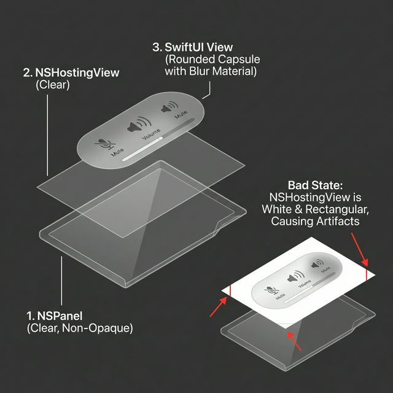

# HUD Architecture

This document explains the layer composition of the Aether HUD to avoid common rendering artifacts (like white corners in Light Mode).

## Layer Stack

1.  **NSPanel (Window)**
    *   `styleMask`: `.borderless`, `.nonactivatingPanel`
    *   `backgroundColor`: `.clear`
    *   `isOpaque`: `false`
    *   `hasShadow`: `false` (Shadows are handled by SwiftUI to avoid rectangular system shadows)

2.  **NSHostingController (TransparentHostingController)**
    *   A custom subclass of `NSHostingController`.
    *   **Crucial**: In `loadView()`, we explicitly set `view.layer?.backgroundColor = NSColor.clear.cgColor` and `view.layer?.isOpaque = false`.
    *   Without this, AppKit often defaults to a white opaque background in Light Mode.

3.  **SwiftUI View (VisualEffectView)**
    *   Background: `NSVisualEffectView` (Material: `.hudWindow`, Blending: `.behindWindow`).
    *   Shape: `RoundedRectangle`.
    *   Border: Low opacity white stroke.

## Why VisualEffectView?

SwiftUI's `.regularMaterial` implementation can sometimes blend incorrectly against a fully transparent window, causing "white square" artifacts. `NSVisualEffectView` is the native macOS component for this and provides perfect blending.
