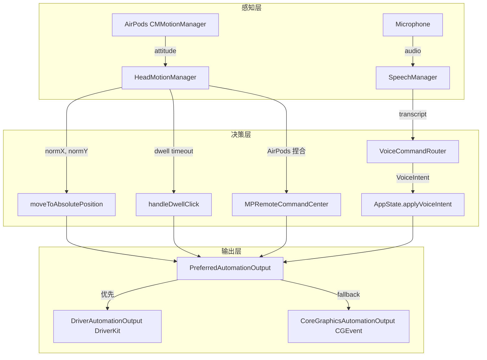

# Aether 代码审核报告：鼠标 + 语音管线

> 审核时间：2026-02-10 18:42  
> 审核范围：`Apps/AetherCore/` 全部 16 个 Swift 源文件

---

## 一、整体架构



---

## 二、鼠标管线（✅ 基本完成）

### 数据流
```
AirPods attitude → 归一化(yaw/pitch) → 平滑滤波 → 绝对坐标 → moveCursor → CGEvent/DriverKit
```

### ✅ 已实现
| 功能 | 文件 | 状态 |
|------|------|------|
| 头部追踪 → 光标移动 | [HeadMotionManager.swift](file:///Volumes/SSD/Projects/Aether/Apps/Apps/AetherCore/HeadMotionManager.swift) | ✅ |
| 左键点击（AirPods 捏合/语音/悬停） | 同上 + [AutomationOutput.swift](file:///Volumes/SSD/Projects/Aether/Apps/Apps/AetherCore/AutomationOutput.swift) | ✅ |
| 右键点击（AirPods 双击/语音） | 同上 | ✅ |
| 双击（AirPods 三连按/语音） | 同上 | ✅ |
| Dwell Click（悬停点击） | [HeadMotionManager.swift#L443-L470](file:///Volumes/SSD/Projects/Aether/Apps/Apps/AetherCore/HeadMotionManager.swift#L443-L470) | ✅ |
| 注意力检测（视线离开暂停） | [HeadMotionManager.swift#L331-L360](file:///Volumes/SSD/Projects/Aether/Apps/Apps/AetherCore/HeadMotionManager.swift#L331-L360) | ✅ |
| 动态范围校准 | [HeadMotionManager.swift](file:///Volumes/SSD/Projects/Aether/Apps/Apps/AetherCore/HeadMotionManager.swift) | ✅ |
| DriverKit HID 输出 | [DriverClient.swift](file:///Volumes/SSD/Projects/Aether/Apps/Apps/AetherCore/DriverClient.swift) | ✅ |
| CGEvent Fallback | [AutomationOutput.swift](file:///Volumes/SSD/Projects/Aether/Apps/Apps/AetherCore/AutomationOutput.swift) | ✅ |
| 连接超时检测 | [HeadMotionManager.swift#L257](file:///Volumes/SSD/Projects/Aether/Apps/Apps/AetherCore/HeadMotionManager.swift#L257) | ✅ |
| Connection Lock（防切换） | [ConnectionLockService.swift](file:///Volumes/SSD/Projects/Aether/Apps/Apps/AetherCore/ConnectionLockService.swift) | ✅ |
| 快捷键（切换追踪/连接锁/PTT） | [HotkeyManager.swift](file:///Volumes/SSD/Projects/Aether/Apps/Apps/AetherCore/HotkeyManager.swift) + [HeadMotionManager.swift](file:///Volumes/SSD/Projects/Aether/Apps/Apps/AetherCore/HeadMotionManager.swift) | ✅ |
| 快捷键 HUD 反馈 | [HotkeyFeedbackHUD.swift](file:///Volumes/SSD/Projects/Aether/Apps/Apps/AetherCore/HotkeyFeedbackHUD.swift) | ✅ |

### ❌ 未实现 / 缺失
| 功能 | 说明 | 优先级 |
|------|------|--------|
| **滚动** | 无任何滚动实现（头部倾斜/语音/手势均无） | 🔴 高 |
| **拖拽** | 无拖拽实现（语音 drag/drop 或捏住拖拽） | 🔴 高 |
| **AirPods 断线自动暂停** | `stopTrackingInternal()` 只在超时触发，无蓝牙路由变化监听 | 🟡 中 |
| **AirPods 连接自启动** | Phase 1.5 TODO 中列出，未实现 | 🟡 中 |
| **DriverKit 键盘注入** | `pasteText()` 和 `undo()` 始终走 CGEvent fallback（代码注释 "not implemented yet"） | 🟢 低 |

---

## 三、语音管线（✅ 基本完成）

### 数据流
```
Microphone → SFSpeechRecognizer → transcript → VoiceCommandRouter.route() → VoiceIntent → 分发
  ├─ 控制指令 → AppState.applyVoiceIntent() → MotionService / ConnectionLock / DwellClick
  └─ 听写文本 → TextInjector.paste() → CGEvent(Cmd+V)
```

### ✅ 已实现
| 功能 | 状态 |
|------|------|
| PTT 模式（按住说话） | ✅ |
| 常驻监听模式 + 唤醒词 ("Aether"/"艾瑟"/"以太") | ✅ |
| 中英文指令路由 | ✅ |
| LLM 增强听写（可选） | ✅ |
| 文本注入（Cmd+V 粘贴） | ✅ |
| 撤销上次注入 | ✅ |

### 语音指令覆盖率对比

| Phase 1.5 TODO 指令 | VoiceCommandRouter 实现 | 状态 |
|---------------------|------------------------|------|
| `开始` / `start` | ✅ `startPointer` | ✅ |
| `停止` / `stop` | ✅ `stopPointer` | ✅ |
| `校准` / `recenter` | ✅ `recenter` | ✅ |
| `悬停开` / `dwell on` | ✅ `setDwell(true)` | ✅ |
| `悬停关` / `dwell off` | ✅ `setDwell(false)` | ✅ |
| `点击` / `click` | ✅ `clickLeft` | ✅ |
| `右键` / `rightclick` | ✅ `clickRight` | ✅ |
| `双击` / `doubleclick` | ✅ `doubleClick` | ✅ |
| `向上滚` / `scroll up` | ❌ **未实现** | 🔴 |
| `向下滚` / `scroll down` | ❌ **未实现** | 🔴 |
| `到顶` / `top` | ❌ **未实现** | 🔴 |
| `到底` / `bottom` | ❌ **未实现** | 🔴 |
| `拖住` / `drag` | ❌ **未实现** | 🔴 |
| `放下` / `drop` | ❌ **未实现** | 🔴 |

---

## 四、发现的问题

### 🔴 Bug / 逻辑错误

**1. `toggleTracking` 快捷键的"启动"分支不可靠**

[HeadMotionManager.swift#L517-L528](file:///Volumes/SSD/Projects/Aether/Apps/Apps/AetherCore/HeadMotionManager.swift#L517-L528)

Event Tap 回调在 **后台线程** 执行，但 `startTracking()` 内部操作 `CMMotionManager` 需要主线程。现在的代码用了 `DispatchQueue.main.async`，这是正确的。但 `startTracking()` 调用 `motionManager.startDeviceMotionUpdates(to: .main)`，如果 AirPods 不在线，会直接返回（因为 `isDeviceMotionAvailable` 为 false）。

**风险**：按快捷键启动时显示 `▶️ 启动追踪` HUD 但实际可能启动失败（AirPods 未连接）。建议：启动后检查是否成功，若失败显示错误 HUD。

**2. `DwellOverlay` 创建时机问题**

[HeadMotionManager.swift#L177](file:///Volumes/SSD/Projects/Aether/Apps/Apps/AetherCore/HeadMotionManager.swift#L177)

`DwellOverlayWindow()` 在 motion callback 闭包内的 `isCalibrated` 初次为 true 时创建。如果 `startTracking()` 被调用但第一帧数据来之前就停止了，`dwellOverlay` 将始终为 `nil`，后续不会创建。

**3. 断线检测不完整**

[HeadMotionManager.swift#L257](file:///Volumes/SSD/Projects/Aether/Apps/Apps/AetherCore/HeadMotionManager.swift#L257)

只有 `handleConnectionTimeout()`（5 秒后仍无数据）和监控定时器。**没有蓝牙路由变化的主动监听**。如果 AirPods 在追踪过程中被系统切换到其他设备，追踪会停留在最后位置直到 watchdog 超时。

### 🟡 可改进项

**4. `VoiceCommandRouter` 缺少滚动/拖拽指令**

[SpeechManager.swift#L22-L73](file:///Volumes/SSD/Projects/Aether/Apps/Apps/AetherCore/SpeechManager.swift#L22-L73)

`VoiceIntent` enum 和 `VoiceCommandRouter.route()` 完全没有 scroll、drag、drop 相关 case。这是 Phase 1.5 TODO 的核心缺失。

**5. 连接锁定不感知追踪状态**

[ConnectionLockService.swift](file:///Volumes/SSD/Projects/Aether/Apps/Apps/AetherCore/ConnectionLockService.swift)

Connection Lock 使用 `AVAudioRoutingArbiter`，但没有与 `HeadMotionManager.isTracking` 联动。启动追踪时不会自动锁定，停止时也不会自动解锁。

**6. `PreferredAutomationOutput.moveCursor` 坐标系不一致**

[AutomationOutput.swift#L129-L151](file:///Volumes/SSD/Projects/Aether/Apps/Apps/AetherCore/AutomationOutput.swift#L129-L151)

`DriverAutomationOutput.moveCursor(to:)` 使用相对增量（dx/dy），而 `CoreGraphicsAutomationOutput.moveCursor(to:desktopMaxY:)` 使用绝对坐标。当从 Driver 切换到 CGEvent fallback 时，`driver.resetRelativeOrigin(to: point)` 同步了起点，但从 CGEvent 切换到 Driver 时（如 Driver 延迟加载），可能会出现一帧跳变。

---

## 五、总结

### 完成度评估

| 模块 | 完成度 | 说明 |
|------|--------|------|
| 头部追踪 → 光标 | **90%** | 核心完成，缺滚动 |
| 点击输入 | **95%** | 左/右/双击全覆盖 |
| 语音控制 | **60%** | 基础指令完成，缺滚动/拖拽 |
| 快捷键 | **100%** | 刚修复，逻辑正确 |
| 连接管理 | **50%** | 手动锁定完成，自动管理缺失 |
| DriverKit 输出 | **70%** | 鼠标完成，键盘未实现 |

### 🚨 下一步优先级

1. **🔴 实现滚动**（语音 `scroll up/down` + 头部倾斜）— 没有滚动 = 无法浏览网页
2. **🔴 实现拖拽**（语音 `drag/drop`）— 没有拖拽 = 无法移动窗口/文件
3. **🟡 快捷键启动失败反馈** — 避免 HUD 显示"启动追踪"但实际未成功
4. **🟡 蓝牙断线自动暂停** — 提升稳定性
5. **🟢 Connection Lock 自动联动** — 提升体验
