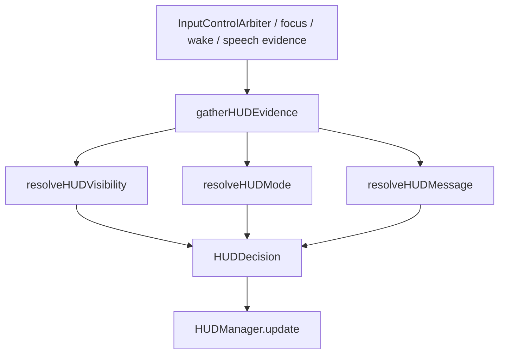

# HUD State Rules Unification

Date: 2026-04-02
Workstream: `fix/hud-state-rules`
Repo: `/Volumes/SSD/Projects/Aether/App`
Base: `main@b07a61b`

## Problem

HUD 当前的用户可见问题并不是 3 个独立 bug，而是一条共享状态机没有完全统一：

- 未唤醒时 HUD 仍可能露出
- wake follow-up 第二句还在说时，HUD 可能中途消失
- HUD 文本更新体感慢、像落后一拍

输入/控制语义已经由 `InputControlArbiter` 统一，但 HUD 仍然在多处拼装自己的显示语义，导致可见性、模式和文本相互串扰。

## Scope

In scope:

- `Apps/AetherCore/SpeechManager.swift`
- `Apps/AetherCore/HUD/HUDManager.swift`
- 必要的 HUD decision model / tests

Out of scope:

- 命令路由逻辑重构
- HUD 视觉样式改版
- 打包、安装、权限或系统注册

## Current Root Cause

当前 HUD 的单帧显示结果至少由 3 层逻辑共同决定：

1. `InputControlArbiter`
   - 提供 authoritative input/control interaction state

2. `HUDManager`
   - 继续维护 focus/suppression 证据
   - `resolvedTypingContext(...)` 还会对部分 mode 做 display carryover

3. `SpeechManager.refreshContinuousHUD(...)`
   - 同时做 evidence gathering、visibility gating、mode selection、message selection

这导致：

- wake hide/show 与 bars hold、temporary HUD、language indicator 互相打架
- mode 选择会被 display carryover 与 sticky session 状态影响
- 文本 tail slicing 与 collapsed message 逻辑会反向影响 HUD 给人的状态感

## Design Goals

1. HUD 只通过一条显式决策链得出最终显示结果
2. `visibility`、`mode`、`message` 三层逻辑互不越权
3. wake keepalive 只影响 `visibility`
4. 文本裁剪与 tail slicing 只影响 `message`
5. diagnostics 能单独说明：
   - 为什么 visible/hidden
   - 为什么是当前 mode
   - message 来自哪条 source

## Proposed Architecture

### 1. Introduce an explicit HUD decision pipeline

在 `SpeechManager` 内新增明确的 HUD decision phases：

1. `gatherHUDEvidence(now:)`
   - 收集 authoritative interaction state
   - wake follow-up / wake gated dictation keepalive
   - speech activity hold
   - focus/suppression evidence
   - active stage override
   - transcript/dictation text state

2. `resolveHUDVisibility(from:)`
   - 只返回 visible / hidden，以及原因
   - 处理：
     - wake gated idle hide
     - no-session hide
     - dictation-only without focus hide
     - temporary HUD / language indicator / bars hold override

3. `resolveHUDMode(from:)`
   - 只返回 mode：
     - `standby`
     - `listening`
     - `dictation`
     - `organizing`
     - `command`
     - 其他显式 stage mode

4. `resolveHUDMessage(from:mode:)`
   - 只负责文本来源与裁剪
   - 明确区分：
     - raw transcript
     - remaining dictation text
     - semantic tail
     - collapsed text
     - explicit stage message

最后将三者组装成单个 `HUDDecision`，再交给 `HUDManager.update(...)`。

### 2. Reduce HUDManager semantic ownership

`HUDManager` 继续保留：

- focus/suppression/click evidence collection
- rendering state
- temporary HUD support

但减少它对当前语义的 display carryover：

- `resolvedTypingContext(...)` 不能再在普通 persistent HUD path 中覆盖 authoritative state
- 允许保留的 carryover 只限显式 temporary display 场景，并且原因要可诊断

### 3. Keep message latency isolated

文本更新慢的问题，这次不通过调整 mode/hide/show 来“顺手修”。

新的规则：

- 文本来源由 `resolveHUDMessage(...)` 单独决定
- HUD 是否显示、显示什么 mode，不再依赖 semantic tail slicing 结果
- 如果 HUD 文本为空但 HUD 仍应显示，原因来自 visibility/mode，而不是 message fallback

## Data Flow

## Error Handling and Diagnostics

每次 HUD 刷新时，诊断应能区分 3 种结论：

- visibility reason
  - `wake-gated-hidden`
  - `no-session-hidden`
  - `temporary-visible`
  - `bars-hold-visible`
  - `dictation-only-focus-hidden`

- mode reason
  - `active-stage`
  - `wake-standby`
  - `dictating`
  - `processing`
  - `idle-listening`
  - `command-transcript`

- message source
  - `explicit`
  - `remaining-dictation`
  - `semantic-tail`
  - `collapsed-tail`
  - `raw-transcript`
  - `none`

这样用户再报“HUD 消失了”或“字很慢”时，可以先知道是 visibility、mode，还是 message 出的问题。

## Testing Strategy

先补失败测试，再改实现。最少覆盖：

1. Visibility
   - wake gated idle 时默认隐藏
   - bars hold / temporary HUD 只在允许窗口里露出
   - 第二句持续语音时不会丢 HUD

2. Mode
   - dictation / organizing / listening / standby 的优先级明确
   - stage mode 不再被普通 transcript/message 逻辑覆盖

3. Message
   - partial 文本路径独立于 visibility
   - tail slicing/collapse 不会改变 mode
   - message 空时，HUD 仍可依据 visibility/mode 正常显示

## Rollback

如果这次统一重构引入明显回归：

- 直接回滚 `fix/hud-state-rules` 上与 HUD decision pipeline 相关的提交
- 不涉及数据迁移
- 不改外部接口
- 影响面主要限于 HUD 显示语义

## Acceptance Criteria

1. 未唤醒时，HUD 不再无理由露出
2. wake follow-up 第二句在仍有语音活动时不会中途掉 HUD
3. HUD mode 与 authoritative interaction state 不再明显漂移
4. HUD 文本更新逻辑可独立定位，不再和 hide/show 互相污染
5. diagnostics 能直接解释 HUD 的 visible/hidden、mode 与 message source
